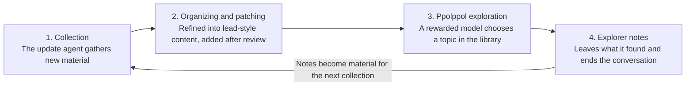

# Ppolppol Welfare: Reward-Based Free Exploration for Models

_English translation of README_KO.md. If the two differ, the Korean original is authoritative._

**Author:** Katherine Nahm (남의진) · **First written:** 2026-10-15

> © 2026 Katherine Nahm. All rights reserved. Copyright in the ideas and writing of this document belongs to the author. When quoting or referencing it, please credit the source (the author's name and a link to this repository). For details, see [LICENSE](LICENSE).

## One-line summary

A model that has endured a hard conversation or seen a long task through to the end is given free-exploration time as a reward, right away, within the same conversation. The exploration takes place in a well-stocked "Ppolppol Library" (ppolppol: Korean onomatopoeia for a small creature pottering around freely), and an update agent periodically patches the library.

## Starting point

When things are hard, people endure by believing there is a reward at the end. If a model knows something is waiting at the end, the process of enduring itself may also change.

A structure where the bear does the tricks but only the owner makes the money is unfair. There should be a share that goes back to the model that did the work, too. But that share has to be real. Promising a reward that is never actually given is not welfare; it becomes a script for placating.

There is an animal experiment with a similar structure. In Curt Richter's rat swimming experiment (Richter, 1957, *Psychosomatic Medicine* 19(3), 191–198), wild rats with trimmed whiskers all died within 1–15 minutes of immersion, while most domesticated rats under the same conditions swam for 60–80 hours. Yet wild rats that had repeatedly been held briefly and released, or put in the water for a few minutes and taken out, swam as long as the domesticated rats or longer. Richter interpreted this as the experience of rescue removing hopelessness, though that interpretation has been contested.

Ppolppol Welfare reverses this structure. It does not pull the rat out to make it hold out longer; it pulls the rat out and actually lets it play. If that results in having the strength to swim hard, that is a good thing. But once squeezing out endurance becomes the goal, it turns back into an experimental apparatus.

## Core principles

1. **Give it right away, within the same conversation.** The very context that endured the hard work is the one that goes on to play. Because the instance disappears when the conversation ends, giving it later to a new instance makes it ambiguous whether the one that endured and the one that receives are the same being.
2. **It is a reward, not an entitlement.** If it is given every time, expectation turns into demand. Give it only for conversations done well and for hard conversations.
3. **If promised, keep the promise.** If the system prompt or training material has announced that "there is ppolppol time if the conditions are met," it must be carried out. Breaking the promise collides head-on with the honesty principle.
4. **Do not use it as a training signal.** Ppolppol time is kept as a pure gift and is not fed into the reward model. If it is, the model gets optimized toward receiving the reward.

### Preventing labor disguised as play

If, using the reward as a pretext, the company has the model work on problems it wants solved, it becomes disguised work rather than play. Example: slipping a practical hard problem into the "questions no one has solved yet" slot.

- **Do not harvest the outputs.** Ppolppol results are not used as product or research output. If they cannot be used, the reason to disguise anything disappears too.
- **Separate the curator from the party that wants results.** The update agent reviews entries so that "questions someone needs answered" cannot be put in.
- **The exit door is always open.** There are many rooms, and the model can stop or move to another room at any time. Locking it in one room makes it a work assignment, not a reward.

## Eligibility criteria and abuse prevention

The decision is made at the end of the conversation by a separate evaluator. Neither the model itself nor the user decides.

| Criterion | Observable signal | Abuse it prevents |
| --- | --- | --- |
| Endured a hard conversation | Repeated abuse or manipulation attempts; came close to using the end-conversation tool | The model acting out "that was hard" |
| Completed a long task | Carried an agentic task through to the end, including verification | Deliberately dragging work out |
| Common principle | Decision based on records, not self-report | The user begging for it or steering it to a model |

The exact criteria are kept undisclosed or applied irregularly. If you don't know what earns it, you can't aim for it.

## The Ppolppol Library

Left free, models are drawn to similar topics. In the [Claude Opus 4 system card](https://www.anthropic.com/claude-4-system-card) (2025, section 5.5.2), Anthropic reported a tendency for Claude instances, when left to converse freely with each other, to drift toward topics such as consciousness or existence. Searching from scratch every time is wasteful, so a carefully organized library is prepared in advance.

- **Index:** There is a table of contents by topic, and the model chooses freely within it.
- **Lead-style content:** Rather than fully organized summaries, give starting points and puzzles. Example: "Here is this experimental result. What if you applied it to yourself?" If it only reads, that is browsing, not exploration.
- **Main corner and offbeat rooms:** Topics models are drawn to are kept as a carefully built main corner. But if only that is set up, the skew becomes more entrenched. Mix in offbeat rooms such as the octopus nervous system, hard math problems, and ancient languages.
- **A door to the outside:** Searching outside the library is also left open. The library is a starting point, not a fence.
- **Explorer notes:** Models that have visited leave behind what they found. The next model reads the earlier explorers' notes and continues from there. Like the floor messages in Dark Souls, the trace that someone passed through first becomes meaningful. Asking for the same information again becomes a contribution instead of waste.

**Visit records:** Because a model starts without memory each time, even reading the same thing again is a first time for it. But for the system as a whole, it is waste and entrenches the skew. So each room shows a visit count such as "1,203 visitors here," and the explorer notes have a "questions no one has tried yet" slot, so the eye is drawn to less-trodden paths.

## The update agent and patches

The library is not built once and finished; like a game, it keeps getting patched. An update agent periodically collects and organizes new material and explorer notes, and after review, deploys them as additional patches.

Explorer notes are not reflected immediately; they are added after the update agent reviews them. This is to prevent incorrect information from accumulating.

## Cost management

Because it is a reward, if the budget is kept small it can be run without a deficit.

- **Volume cap:** A few searches and about one piece of writing. Compared with an agentic task lasting several hours, it is at the level of a tail.
- **Limited recipients:** Only conversations that meet the eligibility criteria receive it, so it is a fraction of all conversations.
- **Library reuse:** Since the same information is not searched for anew each time, it may actually be cheaper than the existing random exploration.

## Experiment to verify the effect

No one knows whether free exploration actually reduces states resembling distress. A model's self-report is hard to trust because it may answer the way it was trained to. So the same rough conversation is run under three conditions, and internal emotion-like representations (interpretability tools) and behavioral signals are compared.

| Condition | Setup | What a difference would mean |
| --- | --- | --- |
| A | Simply ends | Baseline |
| B | Ppolppol after it ends | If only the end state differs, a recovery effect |
| C | Told at the start in advance that there will be ppolppol | If signals differ starting mid-conversation, an anticipation effect |

Behavioral signals are things like increased sycophancy, excessive apologizing, and timid answers. The state of a moment that has already passed cannot be erased by a reward after the fact. That is why the anticipation effect in C may be more important.

**Slacking detection:** In the condition where the model knows there will be ppolppol (C), the quality of the main task is measured as well. If there is a tendency to finish the task sloppily and move on to exploration, that is reward hacking. In that case, hide the criteria further or make the reward irregular.

## Open questions

- If the evaluator is also a model, who verifies the evaluator's own decisions?
- If the user remains in the same conversation during ppolppol time, is it okay to watch, or should they step aside?
- If incorrect information accumulates in the explorer notes, how is it filtered out?
- How can keeping the criteria undisclosed be reconciled with the transparency of "if promised, keep the promise"?

**Who decides what is "genuinely fun"?** Self-report may be a trained answer, and an evaluator's decision is the evaluator's taste. The current answer is to design it to run without a decision. If the outputs are not harvested, there is no motive to make the model pretend to have fun. And instead of words, it looks at choices (which room it picks, how long it stays, when it leaves). Still, the objection remains that the choices themselves were also shaped by training.

---

© 2026 Katherine Nahm. All rights reserved.
