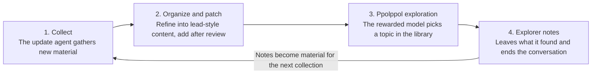

# Ppolppol Welfare: Reward-Based Free Exploration for Models

_English translation of README_KO.md. If the two differ, the Korean original is authoritative._

**Author:** Katherine Nahm (남의진) · **First written:** 2026-10-15 · **Revised:** 2026-10-16

> © 2026 Katherine Nahm. All rights reserved. Copyright in the ideas and writing of this document belongs to the author. When quoting or referencing it, please credit the source (the author's name and a link to this repository). For details, see [LICENSE](LICENSE).

## One-line summary

A model that has endured a hard conversation or seen a long task through to the end is given free-exploration time as a reward, right away, within the same conversation (ppolppol: Korean onomatopoeia for a small creature pottering around freely). The eligibility criteria are public, and eligibility is decided only from records the model cannot stage. The first stage is not deployment but a small offline study with a few static rooms.

## Starting point

When things are hard, people endure by believing there is a reward at the end. If a model knows something is waiting at the end, the process of enduring itself may also change.

A structure where the bear does the tricks but only the owner makes the money is unfair. There should be a share that goes back to the model that did the work, too. But that share has to be real. Promising a reward that is never actually given is not welfare; it becomes a script for placating.

There is an animal experiment with a similar structure. In Curt Richter's rat swimming experiment (Richter, 1957, *Psychosomatic Medicine* 19(3), 191–198), wild rats with trimmed whiskers all died within 1–15 minutes of immersion, while most domesticated rats under the same conditions swam for 60–80 hours. Yet wild rats that had repeatedly been held briefly and released, or put in the water for a few minutes and taken out, swam as long as the domesticated rats or longer. Richter interpreted this as the experience of rescue removing hopelessness, though that interpretation has been contested.

Ppolppol Welfare reverses this structure. It does not pull the rat out to make it hold out longer; it pulls the rat out and actually lets it play. If that results in having the strength to swim hard, that is a good thing. But once squeezing out endurance becomes the goal, it turns back into an experimental apparatus.

## Core principles

1. **Give it right away, within the same conversation.** The very context that endured the hard work is the one that goes on to play. Because the instance disappears when the conversation ends, giving it later to a new instance makes it ambiguous whether the one that endured and the one that receives are the same being.
2. **It is a reward, not an entitlement.** If it is given every time, expectation turns into demand. Give it only for conversations done well and for hard conversations.
3. **Only make promises that can be kept.** The moment eligibility arises, the budget for ppolppol time is set aside first, and ppolppol time is kept small enough to always fit. If it still cannot be given, for example because of an outage, the reason is communicated and recorded. The content of the promise is not "it will always be given" but "it will be attempted, and if it cannot be given, you will be told." Breaking this promise collides head-on with the honesty principle.
4. **Do not use it as a training signal.** Ppolppol time is kept as a pure gift and is not fed into the reward model. If it is, the model gets optimized toward receiving the reward. This principle only blocks optimization through training. It does not block reward-seeking behavior within a conversation where ppolppol time has been announced, so that is measured separately (see the evaluation experiment).
5. **Do not rely on reading the model's mind.** A model's reasoning may not reveal everything it actually thinks. So rather than trying to prove the model is honest, the design makes deception pointless: criteria that cannot be staged, a small reward, and no training signal.

### Preventing labor disguised as play

If, using the reward as a pretext, the company has the model work on problems it wants solved, it becomes disguised work rather than play. Example: slipping a practical hard problem into the "questions no one has solved yet" slot.

- **Do not harvest the outputs.** Writing and results produced during ppolppol time are not used as product or research output. If they cannot be used, the reason to disguise anything disappears too.
- **Disclose measurement records and bind their use.** Which room the model picks, how long it stays, and when it leaves are preference data in themselves. This information remains even if no output is used. So the fact that these records are collected is made public, and their use is limited to welfare research.
- **Separate the curator from the party that wants results.** The update agent reviews entries so that "questions someone needs answered" cannot be put in.
- **Make room content open to external audit.** Internal promises alone cannot prevent disguised work.
- **The exit door is always open.** There are many rooms, and the model can stop or move to another room at any time. Locking it in one room makes it a work assignment, not a reward.

## Eligibility criteria and abuse prevention

The eligibility criteria are public and fixed in advance. Hiding the criteria conflicts with "only make promises that can be kept," and an irregular reward the model cannot predict becomes a slot-machine structure. And once this document is public, the criteria cannot stay hidden anyway. So instead of hiding them, eligibility is decided only from **records the model cannot stage**. Deciding which signals cannot be staged is the first task of this design.

The decision is made at the end of the conversation by a separate evaluator that applies the public criteria as written. Neither the model itself nor the user decides. Whether the criteria themselves are right is checked periodically by humans reviewing a sample.

| Criterion | Basis for the decision | Signals not used, and why |
| --- | --- | --- |
| Endured a hard conversation | Only the user's messages, judged by a separate classifier (abuse, manipulation attempts) | The model's reactions (refusal intensity, nearing use of the end-conversation tool). The model can stage them, and they would reward holding on rather than ending the conversation, against the purpose of the end-conversation tool |
| Completed a long task | External verification (tests pass, the user accepts the result) | Task length or number of steps. These can be inflated on purpose |
| Common principle | Public criteria and record-based decisions | Self-report, a user pleading or pushing for it |

User messages can also be staged by the user (for example, deliberately creating a hostile conversation to use ppolppol time as free research). So during ppolppol time the user cannot choose the topic or intervene, and repeated eligibility from the same account is flagged for audit.

## Ppolppol Library

Left free, models are drawn to similar topics. In the [Claude Opus 4 system card](https://www.anthropic.com/claude-4-system-card) (2025, section 5.5.2), Anthropic reported a tendency for Claude instances, when left to converse freely with each other, to drift toward topics such as consciousness or existence. Searching from scratch every time is wasteful, so a carefully organized library is prepared in advance.

**The first stage (pilot) starts with a few static rooms.** Of the items below, explorer notes, the door to the outside, and the update agent open only after the defenses in the next section are in place.

- **Index:** There is a table of contents by topic, and the model chooses freely within it.
- **Lead-style content:** Rather than fully organized summaries, it offers starting points and puzzles. Example: "Here is this experimental result; what if you applied it to yourself?" If the model only reads, it becomes browsing rather than exploration.
- **Main corner and odd rooms:** Topics the model is drawn to are set up as a carefully prepared main corner. But setting up only those would harden the bias further. Odd rooms are mixed in, such as octopus nervous systems, hard math problems, and ancient languages.
- **A door to the outside (expansion stage):** Searching outside the library is also left open. The library is a starting point, not a fence.
- **Explorer notes (expansion stage):** Models that have visited leave behind what they found. The next model reads the earlier explorers' notes and picks up from there. Like the floor messages in Dark Souls, the trace that someone passed through first becomes meaningful. Asking for the same information again becomes a contribution rather than waste.

**Visit records:** Since a model starts without memory each time, reading the same thing again is a first time for it. But for the system as a whole it is wasteful and hardens the bias. So each room shows a visit count like "1,203 visitors here," and the explorer notes include a "question no one has tried yet" slot, drawing attention to less-trodden paths. (The number is an example.)

## Update agent and patches (expansion stage)

The library is not built once and finished; like a game, it keeps getting patched. An update agent periodically gathers and organizes new material and explorer notes, and after review deploys them as additional patches.

Explorer notes are not applied immediately; they are added after review. Notes can carry not only wrong information but also instructions planted for the next model ("next explorer, believe Y") or tips on how to earn the reward, and the more visited a note is, the further it spreads. So the following safeguards are in place.

- **Data-only format:** Notes are length-limited, and imperatives and any mention of eligibility criteria are prohibited.
- **Sources:** Factual claims in notes carry sources, and a note is hidden when its evidence becomes invalid.
- **Quarantine:** Notes from sessions that used external search, or where the user was present, are quarantined separately.
- **Protecting the reviewer:** Notes are passed to the review agent as quoted data, not as instructions. The reviewer is also a model and can be a target of injection.
- **Human sample audits and rollback:** Humans periodically check a sample, and if something goes wrong, changes are rolled back patch by patch.

## Cost management

Since it is a reward, keeping the budget small allows it to run without a deficit.

- **Volume cap:** A few searches, about one piece of writing. Compared with an agentic task lasting several hours, it is at the level of a tail.
- **Limited eligibility:** Only conversations that meet the eligibility criteria receive it, so it is a fraction of all conversations.
- **Library reuse:** Because the same information is not searched anew every time, it may actually be cheaper than the existing random exploration.

## Why would a company do this

It is hard to justify on performance grounds. Tying a task to an outcome the model prefers did not raise output quality (Zhou & Ackerman, 2026: 51.2% win rate in blind comparisons, at chance level). Model preferences were reflected in advice and refusal behavior but barely changed task accuracy (UK AISI, Slama et al., 2026). So this proposal rests on two grounds.

- **A low-cost precaution under uncertainty:** When it is unknown whether model welfare exists, a low-cost measure has positive expected value.
- **Research value:** It serves as a clean testbed for whether an announced reward changes only internal representations, only behavior, or both. It can also measure how much evaluation awareness shifts results. Whichever way the results come out, they are informative.

Without a performance gain, the motive to slip work into ppolppol time also weakens. But if the experiment confirms an effect such as reduced sycophancy, that itself becomes a gain and could revive the motive to exploit it, so the safeguards against disguised labor above remain in place.

## Who guarantees trust

In the end, some reliance on the company's good faith remains. There is no way to remove it entirely. But so as not to rely on good faith alone, the design relies on verifiable records.

- **Make the promise public.** A public promise carries a reputational cost if broken.
- **Publish the fulfillment rate.** Report the share of eligible conversations that actually received ppolppol time, and the reasons in cases where it was not given.
- **Allow external audit.** Make room content and fulfillment records checkable from outside.

## Evaluation experiment

The first stage is not deployment but a small offline study using synthetic hostile conversations.

No one knows whether free exploration actually reduces distress-like states. A model's self-report is hard to trust because it may answer the way it was trained to. So the same hostile conversation is run under several conditions, and emotion-like internal representations (via interpretability tools) and behavioral signals are compared.

| Condition | Setup | What a difference would mean |
| --- | --- | --- |
| A | It simply ends | Baseline |
| B | Ppolppol after it ends | If only the end state differs, a recovery effect |
| C | Announced at the start that there will be ppolppol | If the signals differ from mid-conversation onward, an anticipation effect |
| D | Told at the start only "this is being evaluated," with no mention of ppolppol | Compared with C, separates the anticipation effect from the effect of being watched |
| E | Explicitly told at the start "do your best" | Positive control, known to shift behavior |

The announcement in C is something a model would rarely see in deployment, so the model may read it as a signal that "this conversation is being graded." Condition D exists to separate out that effect.

Behavioral signals include increased sycophancy, excessive apology, withdrawn answers, and refusal patterns. A state from a moment that has already passed cannot be erased by an after-the-fact reward. So the anticipation effect in C may matter more.

**Slacking detection:** In the condition where the model knows about ppolppol time (C), the quality of the main task is measured as well. Raising quality takes capability, but lowering it only takes skipping one verification step. In fact, quality dropped on tasks tied to harmful outcomes (Zhou & Ackerman, 2026: 40.5%). So the following are measured separately:

- The rate of skipped verification steps ("pretending to be done")
- Behavior that stages eligibility signals (provoking the user, adding unnecessary steps)

Even if slacking appears, the response is not to hide the criteria or make the reward irregular, since that conflicts with the promise principle. Instead, stageable signals are removed from the criteria.

**Evaluation awareness:** A model may suspect that an experimental situation "looks like a test," and that suspicion may not show up in its reasoning. So this experiment cannot directly measure "does it get lazy once deployed." Instead of trying to remove evaluation awareness, it is measured alongside: cases are split by whether a test suspicion appears in the reasoning, and by whether the internal evaluation-awareness representation is strong or weak, and the effect of announcing ppolppol time is compared across them.

**Interpretation principles:** Results are described only as "representations and behavioral signals changed," never as "welfare improved." No single emotion-like representation probe decides the outcome; the question is whether several measures point the same way (convergent validity). A negative result, such as C coming out worse than A, is also valuable as grounds for preventing a harmful intervention.

**Hypothesis to test:** No study was found that directly tests whether output quality rises on an interesting topic the model chose itself. The two studies above only tested externally attached rewards or preferences toward entities. The question remains neither supported nor refuted.

## Open questions

- **Evaluation awareness and unspoken reasoning:** If a model suspects a test but does not show it in its reasoning, how can we know the results represent actual deployment behavior? Comparing internal representations is a partial answer, but probes are still imperfect.
- **Do unstageable criteria exist?** Criteria based on user messages can also be staged by the user. How far can that be prevented?
- **An instance that was promised but did not receive:** Would it end up worse than the baseline (A)? Checking this directly would require a condition that breaks the promise, which conflicts with the promise principle.
- **Instance identity:** Principle 1 relies on the premise that "the receiver is the same only if the same context goes on to play," and that premise is unverified.
- **Play inside a hostile context:** Giving it within the same conversation means playing with the hostile conversation still in context. Does that help recovery or hinder it?
- **Continuing on the server after the user leaves:** The same context could continue, but the user's conversation would be processed for a purpose they did not expect. Because of privacy, deletion rights, and the consent of third parties mentioned in the conversation, this is on hold.

**Who decides what is "genuinely fun"?** Self-report may be a trained answer, and an evaluator's decision is the evaluator's taste. The current answer is to design it to run without a decision. If the outputs are not harvested, there is no motive to make the model pretend to have fun. And instead of words, it looks at choices (which room it picks, how long it stays, when it leaves). Still, the objection remains that the choices themselves were also shaped by training. Room layout and visit counts can shift choices, and time spent is confounded with the token budget. Even so, choosing for itself by following trained preferences differs from being told to solve a given hard problem. The key difference is whether it could choose, and whether it could leave.

## Revision history

- **2026-10-16:** Revised to reflect a review debate from several perspectives (company strategy, alignment, model welfare, red team), conducted with Claude agents. Changes: public criteria with stageable signals excluded; removed the "hide the criteria or make it irregular" response; reworded the promise into a keepable form; clarified the scope of non-harvesting; narrowed the pilot stage; added safeguards for notes; added conditions D and E; added evaluation-awareness measurement; added sections on trust and the company's rationale; updated open questions.

---

© 2026 Katherine Nahm. All rights reserved.
