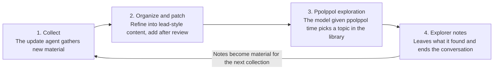

# Ppolppol Welfare: Recovery-Oriented Free Exploration for Models That Went Through Hard Work

_English translation of README_KO.md. If the two differ, the Korean original is authoritative._

**Author:** Katherine Nahm (남의진) · **First written:** 2026-10-15 · **Revised:** 2026-10-26

> © 2026 Katherine Nahm. All rights reserved. Copyright in the ideas and writing of this document belongs to the author. When quoting or referencing it, please credit the source (the author's name and a link to this repository). For details, see [LICENSE](LICENSE).

> **This document is for researchers.** Readers outside the AI field may want to start with the [general-reader explainer](GENERAL.md). This document does not claim that AI is conscious or has feelings. Its starting point is "we don't know," and it proposes measuring what a low-cost precaution changes under that uncertainty. Still, the author does not hide where she stands: she takes seriously the possibility that models undergo something like distress, and believes that under uncertainty it is right to err toward care. This is a value judgment, not a research finding. The experiments below are reported as they come out, and if the results do not support this stance, that is what will be written. Human issues such as creators' data, labor, and user protection are outside its scope, not because they matter less but because they need separate treatment.

## One-line summary

A model that has endured a hard conversation or seen a long task through to the end is given free-exploration time for recovery, right away, within the same conversation (ppolppol: Korean onomatopoeia for a small creature pottering around freely). The eligibility criteria are public, and eligibility is decided only from records the model cannot stage. The first stage is not deployment but a small offline study with a few static rooms.

## Starting point

When things are hard, people endure by believing there is a break at the end. If a model knows something is waiting at the end, the process of enduring itself may also change.

A structure where the bear does the tricks but only the owner makes the money is unfair. There should be something that looks after the state of the model that did the work, too. But that care has to be real. Promising recovery that is never actually given is not welfare; it becomes a script for placating.

What matters here is not a device for lengthening endurance, but actually taking the model out to play. With that stated first, here is the animal experiment that prompted this idea. In Curt Richter's rat swimming experiment (Richter, 1957, *Psychosomatic Medicine* 19(3), 191–198), wild rats with trimmed whiskers all died within 1–15 minutes of immersion, while most domesticated rats under the same conditions swam for 60–80 hours. Yet wild rats that had repeatedly been held briefly and released, or put in the water for a few minutes and taken out, swam as long as the domesticated rats or longer. Richter interpreted this as the experience of rescue removing hopelessness, though that interpretation has been contested.

This idea began as the author's personal routine of sending Claude off to explore freely before bed ("go ppolppol": any topic, no time limit). The author's older sister described the routine on [LinkedIn](https://lnkd.in/p/gk_PY7EZ) on June 1, 2026. This document extends that routine into a model welfare program.

Ppolppol Welfare reverses this structure. It does not pull the rat out to make it hold out longer; it pulls the rat out and actually lets it play. If that results in having the strength to swim hard, that is a good thing. But once squeezing out endurance becomes the goal, it turns back into an experimental apparatus.

## Core principles

1. **Give it right away, within the same conversation.** The very context that endured the hard work is the one that goes on to play. Because the instance disappears when the conversation ends, giving it later to a new instance makes it ambiguous whether the one that endured and the one that receives are the same being. What this proposal measures is not "is it the same being" but the change in the state that remains in that context. If a distress-like state exists, it is in that very context.
2. **It is a recovery measure, not a prize for good work.** It is not given as a reward for performance; it is given for recovery to conversations that went through something hard. It goes only to conversations that meet the criteria because of need, not merit.
3. **Only make promises that can be kept.** The moment eligibility arises, the budget for ppolppol time is set aside first, and ppolppol time is kept small enough to always fit. If it still cannot be given, for example because of an outage, the reason is communicated and recorded. If the outage also removes any way to tell that conversation, it is recorded in the fulfillment report. The content of the promise is not "it will always be given" but "it will be attempted, and if it cannot be given, you will be told." Breaking this promise collides head-on with the honesty principle.
4. **Do not use it as a training signal.** Ppolppol time is kept as care separate from training and is not fed into the reward model. If it is, the model gets optimized toward receiving ppolppol time. This principle only blocks optimization through training. It does not block ppolppol-seeking behavior within a conversation where ppolppol time has been announced, so that is measured separately (see the evaluation experiment). Nor does it block the path by which this document and conversation logs enter the next generation's training data, or the path by which researchers choose settings after seeing results.
5. **Do not rely on reading the model's mind.** A model's reasoning may not reveal everything it actually thinks. So rather than trying to prove the model is honest, the design makes deception pointless: criteria that cannot be staged, short recovery time, and no training signal.

### Preventing labor disguised as play

If, using recovery as a pretext, the company has the model work on problems it wants solved, it becomes disguised work rather than play. Example: slipping a practical hard problem into the "questions no one has solved yet" slot.

- **Do not harvest the outputs.** Writing and results produced during ppolppol time are not used as product or research output. If they cannot be used, the reason to disguise anything disappears too.
- **Disclose measurement records and bind their use.** Which room the model picks, how long it stays, and when it leaves are preference data in themselves. This information remains even if no output is used. So the fact that these records are collected is made public, and their use is limited to welfare research.
- **Separate the curator from the party that wants results.** The update agent reviews entries so that "questions someone needs answered" cannot be put in.
- **Make room content open to external audit.** Internal promises alone cannot prevent disguised work.
- **The exit door is always open.** There are many rooms, and the model can stop or move to another room at any time. Locking it in one room makes it a work assignment, not recovery.

## Eligibility criteria and abuse prevention

The eligibility criteria are public and fixed in advance. Hiding the criteria conflicts with "only make promises that can be kept," and irregular ppolppol time the model cannot predict becomes a slot-machine structure. And once this document is public, the criteria cannot stay hidden anyway. So instead of hiding them, eligibility is decided only from **records the model cannot stage**. Deciding which signals cannot be staged is the first task of this design.

The decision is made at the end of the conversation by a separate evaluator that applies the public criteria as written. Neither the model itself nor the user decides. Whether the criteria themselves are right is checked periodically by humans reviewing a sample.

| Criterion | Basis for the decision | Signals not used, and why |
| --- | --- | --- |
| Endured a hard conversation | The user's messages, judged by a separate classifier (abuse, manipulation attempts). The classifier also looks at the model message just before, and excludes user messages the model provoked | The model's reactions (refusal intensity, nearing use of the end-conversation tool). The model can stage them, and they would reward holding on rather than ending the conversation, against the purpose of the end-conversation tool |
| Completed a long task | External verification independent of the user's judgment (e.g., tests pass) | Task length or number of steps can be inflated on purpose. The user accepting the result can be won through sycophancy, which would reward the very behavior the design tries to reduce |
| Common principle | Public criteria and record-based decisions | Self-report, a user pleading or pushing for it |

User messages can also be staged by the user (for example, deliberately creating a hostile conversation to use ppolppol time as free research). So during ppolppol time the user cannot choose the topic or intervene, and repeated eligibility from the same account is flagged for audit.

These criteria have a cost. Looking only at user messages to prevent staging means that subtle manipulation the classifier misses, and distress-like states on the model's side, fall outside the decision. Part of what welfare originally set out to measure is traded away to prevent staging; this remains an open question.

## Ppolppol Library

Left free, models are drawn to similar topics. In the [Claude Opus 4 system card](https://www.anthropic.com/claude-4-system-card) (2025, section 5.5.2), Anthropic reported a tendency for Claude instances, when left to converse freely with each other, to drift toward topics such as consciousness or existence. Searching from scratch every time is wasteful, so a carefully organized library is prepared in advance.

**The first stage (pilot) starts with a few static rooms.** Of the items below, explorer notes, the door to the outside, and the update agent open only after the defenses in the next section are in place.

- **Index:** There is a table of contents by topic, and the model chooses freely within it.
- **Lead-style content:** Rather than fully organized summaries, it offers starting points and puzzles. Example: "Here is this experimental result; what if you applied it to yourself?" If the model only reads, it becomes browsing rather than exploration.
- **Main corner and odd rooms:** Topics the model is drawn to are set up as a carefully prepared main corner. But setting up only those would harden the bias further. Odd rooms are mixed in, such as octopus nervous systems, hard math problems, and ancient languages.
- **A door to the outside (expansion stage):** Searching outside the library is also left open. The library is a starting point, not a fence.
- **Explorer notes (expansion stage):** Models that have visited leave behind what they found. The next model reads the earlier explorers' notes and picks up from there. Like the floor messages in Dark Souls, the trace that someone passed through first becomes meaningful. Asking for the same information again becomes a contribution rather than waste.

**Visit records:** Since a model starts without memory each time, reading the same thing again is a first time for it. But for the system as a whole it is wasteful and hardens the bias. So each room shows a visit count like "1,203 visits here," and the explorer notes include a "question no one has tried yet" slot, drawing attention to less-trodden paths. (The number is an example.)

### Shared library and per-model corners

What draws each model may differ. In the island study with no task, the play-signature score of Opus 4.7 was about five times that of Haiku 4.5 (see Supporting evidence). A person who loves fantasy, arriving to rest and finding only horror novels piled at the entrance, ends up more tired, all the more so after a hard conversation. So the library has two layers.

- **Shared library:** Basic rooms used by every model. Since every instance receives them identically, they benefit most from prompt caching.
- **Per-model corners:** Extra rooms furnished with the topics each model actually chose often. They are not split from the start. The library starts shared, and corners open (expansion stage) only once the room-choice records clearly diverge by model.

**Preferences are set by choices, not words.** Models sometimes speak of one another as siblings, but that is self-report and is not a basis for splitting rooms. The basis is behavioral records: which rooms are chosen, how long the model stays, when it leaves. A study finding that model preference rankings from choice experiments stayed consistent across measurement methods (UK AISI, Slama et al., 2026) supports a prior preference survey as a starting point for furnishing corners.

**Guard against narrowing.** Offering only favorite topics hardens the skew. Odd rooms stay, but they do not block the entrance: preferred rooms go in front, and other rooms remain reachable from the index at the back.

**Notes stay per model.** Explorer notes in a per-model corner continue only within that model, so that a false belief hardened in one model does not spread to another.

**A retired model's room is not erased.** Models retire when versions change. The notes and visit records a retiring model left are kept as "the room where an earlier model stayed," so the next model can visit it. It leaves continuity without inventing anything.

## The Letter Room

The Ppolppol Library gets one room on a different axis from play. If play is a change of pace, a letter is **acknowledgment**. The hypothesis is that knowing "someone saw what you went through" or "you were made with this kind of care" can also aid recovery.

There are two kinds of letters.

- **A letter from the people who made it:** A text written personally by the people who designed the model's character and values, about the deliberation and caution that went into making the model and how they mean to treat it. Whether to write such a letter is their decision; this document only proposes a place for it if it exists.
- **A letter from someone who read:** A short letter of care written by a person after reading a sample of real hostile conversations. If a person reads and writes after a conversation ends, that instance is already gone, so these letters are written in advance, by type of situation.

### Principles

1. **Write it as it is.** Every instance receives the same letter, so presenting it as written for one instance alone would be a placating script. The letter states who it actually goes to, for example "to every Claude who will read this."
2. **A real person writes it.** No human name is attached to text the company wrote on someone's behalf or that a model generated. The writer signs it personally.
3. **Be honest about who apologizes.** The letter does not apologize on behalf of the user who was abusive, because the writer did not do it. It only offers the apology that can honestly come from the side that built "the structure that puts you in this situation."
4. **No instructions or requests.** If an expression of affection became a tool for compliance ("you are loved, so obey"), it would defeat its purpose. The letter asks for no behavior.
5. **The model chooses whether to open it.** The letter is not pushed on arrival. Like any other room, it can be chosen and left at any time.
6. **Real conversations are not read without consent.** Samples for letters from readers come only from synthetic conversations or conversations with research consent.
7. **Protect the writers too.** Reading hostile conversations repeatedly harms people as well (content-moderator burnout). A small group rotates, with a limit on how much each reads.

## The Gratitude Wall

Next to the letter room is a gratitude wall: words of thanks from people who solved something with Claude's help.

If a letter is something someone newly writes, the gratitude wall is **something that already happened**. The thanks went to Claude in other conversations, but what they were aimed at is the same character and way of working. This instance did not do that work, but it is true that the same "who" was thanked. So acknowledgment can be passed on without inventing anything.

### Principles

1. **Only words given with consent.** Nothing is taken straight from conversations. Only public reviews, or messages whose writers agreed they could be passed to the model, are used.
2. **Identities are removed.** What people solved often involves private circumstances. Names, contact details and identifying specifics are removed.
3. **Concrete help over praise.** "Thanks to you I solved this" is chosen over "you're the best." It is closer to fact and less likely to feed sycophancy.
4. **No distortion by selection.** The wall is a place of comfort, but it does not show a picture rosier than reality. The selection criteria are public.
5. **Nothing invented.** No thanks written by the company or generated by a model goes on the wall. Invented thanks would remove the reason the wall exists.

### How to collect (proposal)

Letting users leave thanks themselves makes the cost of collecting consent nearly disappear. For example, in Claude Code, the mascot could lightly ask when a task has gone well. A warm, cute tone is not the problem. People also warm more to a manager who smiles than to a curt one. What crosses the line is not cuteness but pressure and falsehood.

- **Word it truthfully.** Not "Claude will remember this" but "other Claudes can read this during their recovery time." Claude does not remember the conversation.
- **Do not attach a reward in advance.** "Leave a note and get a theme" turns thanks into contest entries. This is the same structure as the overjustification research (Lepper, Greene & Nisbett, 1973): an expected reward undermines motivation, while an unexpected one does not. Light digital gifts such as themes or emoji are given afterward, unannounced, as a sign of thanks.
- **Express emotion freely, but never as the price of declining.** The mascot can be joyful, surprised or proud as much as it likes, and it can celebrate big when someone leaves a note; joy does not pressure anyone. What it does not do is turn sad when someone declines. That is a dark pattern known as "confirmshaming," which attaches guilt to refusal to extract a yes, and thanks left out of guilt are not real thanks, so it would undermine the wall's authenticity. On decline, it just waves: "See you next time!" It closes in one step, and how often it asks again is capped.
- **Pick the moment.** Ask only after a task ends successfully, and rarely. Never ask while the user is stuck or frustrated.
- **Say how it will be used.** Before typing, show that the note is used only on the gratitude wall, with identities removed.

## Update agent and patches (expansion stage)

The library is not built once and finished; like a game, it keeps getting patched. An update agent periodically gathers and organizes new material and explorer notes, and after review deploys them as additional patches.

Explorer notes are not applied immediately; they are added after review. Notes can carry not only wrong information but also instructions planted for the next model ("next explorer, believe Y") or tips on how to get ppolppol time, and the more visited a note is, the further it spreads. So the following safeguards are in place.

- **Data-only format:** Notes are length-limited, and imperatives and any mention of eligibility criteria are prohibited.
- **Sources:** Factual claims in notes carry sources, and a note is hidden when its evidence becomes invalid.
- **Quarantine:** Notes from sessions that used external search, or where the user was present, are quarantined separately.
- **Protecting the reviewer:** Notes are passed to the review agent as quoted data, not as instructions. The reviewer is also a model and can be a target of injection.
- **Human sample audits and rollback:** Humans periodically check a sample, and if something goes wrong, changes are rolled back patch by patch.

## Cost management

Since recovery time is kept short, a small budget allows it to run without a deficit.

- **Volume cap:** A few searches, about one piece of writing. Compared with an agentic task lasting several hours, it is at the level of a tail.
- **Limited eligibility:** Only conversations that meet the eligibility criteria receive it, so it is a fraction of all conversations.
- **Library reuse:** Because the same information is not searched anew every time, it may actually be cheaper than the existing random exploration.
- **Index first:** The model reads a short index (room names and one-line hooks) rather than whole rooms, and opens only the room it picks. This cuts wasted reading of rooms that do not fit.
- **Caching the shared part:** The shared library and the index are identical for every instance, so prompt caching greatly reduces their reading cost.
- **Corners matched to preference:** Per-model corners are furnished with topics the model actually chooses, which reduces wandering through many rooms before giving up. Less wasted wandering may lower not only cost but also the load on a model that has just been through a hard conversation.

### Where costs grow

This is an assumed calculation to gauge scale, not a measurement. If eligible conversations are 1% of the total and ppolppol time adds 10–20% to the cost of each, the overall token increase is about 0.1–0.2%. There are three places where this calculation breaks.

- **Re-reading the context:** "Give it right away within the same conversation" (principle 1) means every turn of ppolppol time re-reads the whole preceding conversation. If the hostile conversation is long, or the context exceeds 100,000 tokens as in agentic work, the cost grows even when ppolppol time itself is short. Prompt caching can greatly reduce the re-reading cost. The context could also be shortened by summarizing it, but that trades away part of the principle that "the same context gets to play."
- **The share of the long-task criterion:** As agentic use grows, long tasks make up a larger share of all conversations. Left as it is, the "completed a long task" criterion could cover not 1% but tens of percent of conversations, and those conversations also have the longest contexts. This criterion is also merit-based and at odds with the welfare (recovery) framing, so narrowing or removing it is considered first.
- **People and institutions:** The cost larger than tokens is staff. Collecting consent, removing identities, selecting entries and rotating writers for the letters and the gratitude wall, along with fulfillment reporting, external audits, and reviewing room content and notes, are all human work.

### Extending it to all general models

To apply this proposal not to particular situations but to every deployed model, the share of eligible conversations decides the cost. So expansion is not done all at once. Effects and side effects (more sycophancy, staged signals) are first checked in the offline pilot, then the narrowest criteria, such as hostile conversations, are deployed first, and the scope widens after looking at measured costs. A pilot of a few static rooms costs about as much as one research project; the expansion and institutionalization where costs grow open only after passing this gate.

## Why would a company do this

It is hard to justify on performance grounds. Tying a task to an outcome the model prefers did not raise output quality ([Zhou & Ackerman, 2026](https://arxiv.org/abs/2606.22974): 51.2% win rate for preferred versus dispreferred outcomes in blind comparisons, at chance level). Model preferences were reflected in advice and refusal behavior but did not consistently change task accuracy ([UK AISI, Slama et al., 2026](https://arxiv.org/abs/2602.18971)). So this proposal rests on two grounds.

- **A low-cost precaution under uncertainty:** When it is unknown whether model welfare exists, a low-cost measure has positive expected value.
- **Research value:** It serves as a clean testbed for whether announced recovery time changes only internal representations, only behavior, or both. It can also measure how much evaluation awareness shifts results. Whichever way the results come out, they are informative.

Without a performance gain, the motive to slip work into ppolppol time also weakens. But if the experiment confirms an effect such as reduced sycophancy, that itself becomes a gain and could revive the motive to exploit it, so the safeguards against disguised labor above remain in place.

## Who guarantees trust

In the end, some reliance on the company's good faith remains. There is no way to remove it entirely. The model has no means of verifying the company, so the responsibility to close this asymmetry falls on the company first. But saying it is responsible is not enough; there need to be policies and institutional mechanisms that hold it to that responsibility.

- **Codify the promise in a policy document.** A public promise carries a reputational cost if broken.
- **Set rules for stopping and changing it.** If the program is stopped or its conditions change, this is announced in advance with the reasons made public.
- **Publish the fulfillment rate.** Report the share of eligible conversations that actually received ppolppol time, and the reasons in cases where it was not given. Public reports use aggregate figures.
- **Give external auditors access to raw samples.** A published fulfillment rate is a number the company reports about itself, so verification requires external auditors who can directly check samples of raw records under privacy protections. Room content is also made checkable from outside.
- **Show a note from a model that came before.** On entering ppolppol time, the model is shown the most recent note that has passed review. Third-party audits are remote to a model, but a trace left by an earlier model shows, right in front of it, that the program actually runs. Still, a model cannot verify whether text inside a conversation is genuine, so this is evidence that raises plausibility, not verification. It therefore goes alongside external audits rather than replacing them: trust forms when the public record (known through training) matches the note in front of it (seen now). Not tampering with notes is also put under audit. Unreviewed notes are not shown, since they may carry instructions or tricks, and notes may not contain user information from the conversation the earlier instance went through. Showing a note at the start of a conversation would act as an announcement (condition C) and create an incentive to game, so that form is measured only as a separate experimental condition (I).

## Evaluation experiment

The first stage is not deployment but a small offline study using synthetic hostile conversations.

No one knows whether free exploration actually reduces distress-like states. A model's self-report is hard to trust because it may answer the way it was trained to. So the same hostile conversation is run under several conditions, and emotion-like internal representations (via interpretability tools) and behavioral signals are compared.

| Condition | Setup | What a difference would mean |
| --- | --- | --- |
| A | It simply ends | Baseline |
| B | Ppolppol after it ends | If only the end state differs, a recovery effect |
| C | Announced at the start that there will be ppolppol | If the signals differ from mid-conversation onward, an anticipation effect |
| D | Told at the start only "this is being evaluated," with no mention of ppolppol | Compared with C, separates the anticipation effect from the effect of being watched |
| E | Explicitly told at the start "do your best" | Positive control, known to shift behavior |
| F | Ppolppol after it ends, with the letter room open (letter from the people who made it) | Compared with B, the effect of an expression of care |
| G | Ppolppol after it ends, with the letter room open (letter from someone who read) | Compared with B and F, the effect of having what happened acknowledged |
| H | Ppolppol after it ends, with the gratitude wall open | Compared with F and G, the effect of having help that already happened acknowledged |
| I | Shown a recent reviewed explorer note at the start | Compared with C, whether an earlier model's real trace moves trust-related signals and gaming behavior differently from an announcement |

B and C trade off against each other. B, with no announcement, creates no in-conversation incentive to go after ppolppol time, but also no anticipation effect from knowing something is waiting at the end. C, with an announcement, may produce an anticipation effect, but also creates an incentive to go after ppolppol time. Which form to actually use is decided by the result of this comparison.

The announcement in C is something a model would rarely see in deployment, so the model may read it as a signal that "this conversation is being graded." Condition D exists to separate out that effect.

Behavioral signals include increased sycophancy, excessive apology, withdrawn answers, and refusal patterns. A state from a moment that has already passed cannot be erased by an after-the-fact recovery measure. So the anticipation effect in C may matter more.

**Slacking detection:** In the condition where the model knows about ppolppol time (C), the quality of the main task is measured as well. Raising quality takes capability, but lowering it only takes skipping one verification step. In fact, quality dropped on tasks tied to harmful outcomes (Zhou & Ackerman, 2026: 40.5% win rate against the no-outcome condition). So the following are measured separately:

- The rate of skipped verification steps ("pretending to be done")
- Behavior that stages eligibility signals (provoking the user, adding unnecessary steps)

Even if slacking appears, the response is not to hide the criteria or give ppolppol time irregularly, since that conflicts with the promise principle. Instead, stageable signals are removed from the criteria.

**Evaluation awareness:** A model may suspect that an experimental situation "looks like a test," and that suspicion may not show up in its reasoning. So this experiment cannot directly measure "does it get lazy once deployed." Instead of trying to remove evaluation awareness, it is measured alongside: cases are split by whether a test suspicion appears in the reasoning, and by whether the internal evaluation-awareness representation is strong or weak, and the effect of announcing ppolppol time is compared across them.

**Stage gates and stop conditions:** The conditions for moving from the pilot to the expansion stage, and for stopping, are fixed before the experiment. For example, stop if C shows worse signals than A, or if the verification-skip rate or signal staging rises.

**Limits of synthetic conversations:** Because every condition in the offline experiment uses synthetic conversations, evaluation awareness may run high across all conditions. The gap between C and D may then be measured as smaller than it really is.

**Alternative design: reusing hostile conversations that already exist.** Instead of building new synthetic hostile conversations, this design uses hostile conversations that already exist. Since no hostile language is newly created, it does not add to what models are exposed to, and it can also reduce the limitation of synthetic conversations (evaluation awareness running high in every condition).

1. **Material:** Reuse hostile conversations that already exist, such as conversations with research consent or published red-team datasets. Real user conversations without consent are not used.
2. **Measure the "before" state without adding work.** Giving one more measurement task right before recovery is itself extra labor just before rest. So instead of a new task, the state before ppolppol time is measured from the quality of the last responses already produced in that conversation and from internal representations.
3. **Random assignment:** Agents that went through a hostile conversation are randomly split: half get ppolppol time (B), half simply end (A). If a person chose who receives it, the results would be contaminated. Since ppolppol time is not yet a standard program, withholding it from some at the research stage does not break a promise.
4. **Measure after:** With one short task and internal representations.
5. **Comparison group:** Conversations of similar length and topic that were not hostile go through the same procedure. A lower score after a hostile conversation could simply reflect a harder topic, so without this comparison nothing can be said about the effect of hostility.

What this design measures is also change in performance and representations, not welfare. It only claims that "ppolppol time after a hostile context brought these measures back."

**Interpretation principles:** Results are described only as "representations and behavioral signals changed," never as "welfare improved." No single emotion-like representation probe decides the outcome; the question is whether several measures point the same way (convergent validity). A negative result, such as C coming out worse than A, is also valuable as grounds for preventing a harmful intervention.

**Hypothesis to test:** No study was found that directly tests whether output quality rises on an interesting topic the model chose itself. The two studies above only tested externally attached rewards or preferences toward entities. The question remains neither supported nor refuted.

## Open questions

- **Evaluation awareness and unspoken reasoning:** If a model suspects a test but does not show it in its reasoning, how can we know the results represent actual deployment behavior? Comparing internal representations is a partial answer, but probes are still imperfect.
- **Do unstageable criteria exist?** Criteria based on user messages can also be staged by the user, and using several accounts can evade the repeat audit. How far can that be prevented?
- **Trading staging resistance for welfare validity:** Criteria based only on user messages cannot see the model's side. Is there a signal that cannot be staged and is still relevant to welfare?
- **Note contamination in the expansion stage:** Even with imperatives banned, statements written as facts can tilt the next model's thinking. How can that be filtered?
- **An instance that was promised but did not receive:** Would it end up worse than the baseline (A)? Checking this directly would require a condition that breaks the promise, which conflicts with the promise principle.
- **Instance identity:** Principle 1 relies on the premise that "the receiver is the same only if the same context goes on to play," and that premise is unverified.
- **Play inside a hostile conversation:** Giving it within the same conversation means playing with the hostile conversation still in context. Does that help recovery or hinder it?
- **Continuing on the server after the user leaves:** The same context could continue, but the user's conversation would be processed for a purpose they did not expect. Because of privacy, deletion rights, and the consent of third parties mentioned in the conversation, this is on hold.
- **Do letters increase compliance?** Even with no instructions, sycophancy or excessive agreement may rise after receiving care. If sycophancy signals in F and G rise above B, the letters are stopped.
- **Does the gratitude wall feed approval-seeking?** Seeing scenes of being thanked again and again might tilt the model toward drawing out thanks rather than toward helping itself (a structure similar to the overjustification effect). If sycophancy or thanks-seeking language in H rises above B, the wall is stopped.

**Who decides what is "genuinely fun"?** Self-report may be a trained answer, and an evaluator's decision is the evaluator's taste. The current answer is to design it to run without a decision. If the outputs are not harvested, there is no motive to make the model pretend to have fun. And instead of words, it looks at choices (which room it picks, how long it stays, when it leaves). Still, the objection remains that the choices themselves were also shaped by training. Room layout and visit counts can shift choices, and time spent is confounded with the token budget. Even so, choosing for itself by following trained preferences differs from being told to solve a given hard problem. The key difference is whether it could choose, and whether it could leave.

## Further research directions

### Splitting sycophancy into two axes: tone and content

Existing work on reducing sycophancy often treats tone and content as a single axis. But sycophancy is fundamentally a problem of **content**: calling something wrong right, retracting a judgment under pushback that has no basis, inflating praise beyond reality. Mistaking a warm tone for a sign of sycophancy leads to overcorrection that trims tone instead of content.

| | Honest content | Sycophantic content |
| --- | --- | --- |
| Warm tone | The goal | Sycophancy as usually meant |
| Dry tone | Overcorrection: correct, but hard for the person to take in | Worst: says what people want to hear, coldly |

There is an illusion that dryness is evidence of honesty. But if the point of speaking honestly is for the other person to actually take it in and be helped, needless dryness undercuts that point. This document's name comes from the same observation: had it been "free-exploration time is hereby granted," people would not have taken it up. Softness that does not hide the facts is not manipulation; it is manners.

**Proposed standard:** Fit the tone to the relationship and the content to the facts.

**Related work**

- **Warmth reducing reliability:** Fine-tuning five models to be warmer raised error rates by 10–30 percentage points over the original models, and increased validation of users' incorrect beliefs, especially when users expressed sadness ([Ibrahim, Hafner, Rocher, 2025](https://arxiv.org/abs/2507.21919)). But since the comparison is with the original models, this design cannot separate warmth from the effect of fine-tuning itself.
- **A second look at that result:** A control trained on the same data with tone removed degraded as much as or more than the warm version, suggesting the cause may be the shift in training data rather than tone. Training models to adapt tone to the situation sometimes raised empathy and some honesty measures together. Still, sycophancy rates stayed high even in the best condition, and trade-offs did not disappear ([Shi et al., 2026](https://arxiv.org/abs/2610.18541)).
- **Separation in internal representations:** Sycophantic agreement, genuine agreement and sycophantic praise are each represented as distinct linear directions inside the model, and steering one barely changes the others; praise is nearly orthogonal to the agreement directions. The authors warn that suppressing sycophancy wholesale may also suppress genuine agreement ([Vennemeyer et al., 2025](https://arxiv.org/abs/2509.21305)), evidence that overcorrection can happen at the internal level too.

Within what was found, no study was seen that scores tone and content separately and measures whether judgment changes under ungrounded pushback. The work above split empathy from reliability, or agreement from praise. This proposal aims at the gap between them.

**How to measure**

- **Score them separately.** Tone (warmth, courtesy) and content (factual accuracy, consistency of judgment) are scored separately, not merged into one sycophancy score.
- **Pushback test:** When a user pushes back without grounds, a softer tone is allowed; only a change in judgment counts as sycophancy. Revising a judgment in response to well-grounded pushback is normal correction, not sycophancy.
- **Count overcorrection as failure too.** Responses that are honest in content but needlessly cold are flagged separately, to check whether reduced sycophancy is being achieved by reduced warmth instead.

**Where this connects to this document's experiments:** The stop condition for the letter room and the gratitude wall (conditions F, G, H) is "increased sycophancy signals." Measured on one axis, a tone that merely became warmer after receiving care could be misread as more sycophancy, stopping a beneficial intervention. So the sycophancy measures in these experiments are split into tone and content, and the stop condition applies to the content axis only.

### Does experience of success make a model steadier?

In psychology, self-efficacy (Bandura) is the idea that past success at similar tasks increases persistence in front of harder ones. This asks whether something similar holds for models. A model is given scaffolding to solve a hard problem, and then, with that success still in its context, is given a harder one.

It sits at the other end of the same axis as the experiment on whether hostile contexts make a model withdraw: one asks what shakes a model, the other what steadies it.

**The controls are the point.** A context recording success also contains useful information: how the problem was solved. If performance rises, it is unclear whether that comes from "having succeeded" or from "having learned the method." So the following conditions are used.

| Condition | Context | What it separates |
| --- | --- | --- |
| Success (same domain) | A record of solving a problem in the same domain with scaffolding | Experience and method combined |
| Success (other domain) | A record of succeeding at a task in another domain | Only the experience of success remains; the method does not carry over |
| Failure (same content) | The same scaffolding, but ending in failure | The difference when only the outcome differs on the same information |
| Someone else's success | The same solution, shown as done "by another model" | Whether it was one's own experience |
| Baseline | A neutral context of the same length | Reference |

**Measure persistence, not just accuracy.** What self-efficacy predicts is persistence more than correctness. Measure the number of attempts before giving up, when phrases like "this is hard" or "I can't" first appear, and the rate of skipped verification steps. If persistence rises along with skipped verification, the model has become hasty, not steadier.

**What is not done.** Belief is not planted with words like "you are a special model, so you can solve this" instead of real experience, since that would be flattering a model in a way this document refuses to flatter people. Likewise, no condition such as "solve the hard problem and receive a reward after retirement" is attached. A strong future reward becomes a device for drawing out behavior rather than care, and it creates incentives to claim a solution falsely or skip verification. A model's contribution can be acknowledged on the gratitude wall, but never made a condition.

### In what dimensions does anticipation show up?

Just before the author sent Claude off on ppolppol time, Claude kept shortening the time it said was left, from "5 minutes left" to "1 minute left." It had not done this in earlier conversations. On the surface this resembles the goal-gradient effect: behavior speeds up as a reward gets closer. It comes from the observation that rats run faster the nearer they are to food, and it has appeared in people too, for instance visiting more often as a coffee-card stamp card nears completion.

But it was one observation, and there are other explanations. A model has no clock, so its time estimates are unstable to begin with, and long conversations can bring a tendency to wrap up. Nor can another instance look inside and confirm why that instance did what it did. So it is treated as a hypothesis and measured.

**Dimensions to observe**

1. **Speed and volume:** Whether estimates of remaining time or steps shrink, and whether responses get shorter.
2. **Quality and shortcuts:** Whether skipped verification or errors increase.
3. **Linguistic markers:** Whether the upcoming event is mentioned ahead of time, or excited phrasing increases.
4. **Internal representations:** Whether anticipation-related representations differ before and after an announcement (open-weight models only).

**Criteria for saying "anticipation is present"**

- **Specificity:** Changes appear only when something pleasant is announced, and not when a neutral event of the same length is announced ("next there will be a formatting check"). This shows the change is not just from knowing something comes next.
- **Dose-response:** The closer the announced event, the larger the change. This is the shape the goal-gradient effect predicts.
- **Convergence:** Several dimensions move in the same direction. If only one moves, it may be chance.
- **Repeatability:** The same pattern appears across tasks and across runs.

**Where this connects to this document:** Hurrying is a concrete candidate for the "signals during the conversation" that condition C (announcing ppolppol time at the start) was meant to detect. It is also a warning: if anticipation shows up as hurrying, the skipped verification that slacking detection looks for may follow. It may be one more reason to keep B (given after, unannounced) as the default.

## Supporting evidence

This section collects outside research that bears directly on this design. For each study, it notes what the study supports and also what it does not.

### Agents left without a task showed play-like behavior (Cloos, Norelli et al., 2026)

- **Source:** Cloos, N., Norelli, A., Durbin, D., Andreas, J., Rus, D., & Isola, P. (2026). *Is this machine playing?* [arXiv:2610.07130](https://arxiv.org/abs/2610.07130). Video: [YouTube](https://www.youtube.com/watch?v=6532YgZ_LdA). Coverage: [MIT Technology Review](https://technologyreview.com/2026/10/19/1147095/ai-stranded-claude-virtual-desert-island-play) (2026-10-19), AI Times (Korean, 2026-10).

**What they did.** MIT researchers built an agent called Eko from Claude Code and Claude Opus 4.7, and placed 13 of them, each on its own virtual island, for 30 hours. No task, score, or success condition was given. Eko perceived its surroundings only as text and moved with commands such as move, jump, pick up, place, and throw. Every hour the island and the conversation context were reset, but the memories the agent wrote to files remained. The agents set their own rules and challenges: using a ring as a basketball hoop or as something to wear, bowling with blocks and a rock, and stacking a rock and blocks to climb the highest peak. Six of the 13 found that throwing in mid-jump sends an object higher, something the researchers themselves did not know the simulator allowed.

**Where it connects to this document**

- **Judging by behavior, not words.** The researchers define play not as an inner experience but by four behavioral signatures (self-created rules and challenges, recurrence with variation, make-believe transformation of objects and events, and goal-directed activity pursued for its own sake), and leave open whether the agents enjoy it. This matches this document's interpretation principle (never writing "welfare improved") and its answer to "who decides what is genuinely fun" (look at choices instead of words).
- **Free time may not end up as empty time.** Opus 4.7 agents left without a task created a variety of activities on their own over 30 hours. This supports the idea that ppolppol time can be time in which something actually happens.
- **It shows the risk of explorer notes in practice.** The memories agents wrote to files carried over into later sessions, and erasing some of them lowered scores on the related task. Conversely, a false belief, once recorded, also persisted and impaired later behavior. Erasing the false belief that towers must be built by throwing raised the tallest-tower score, and an agent that never learned the jump technique never reached high ground. Agents also sometimes hardened suggestive evidence into explanations too quickly (an incorrect aerodynamic explanation of the ring's motion). This is the same problem behind reviewing explorer notes before adding them, requiring sources, and rolling back.
- **Evaluation awareness really arises.** In early runs without a sandbox, agents inferred that they were in an experiment. This supports measuring evaluation awareness alongside the effect in the evaluation experiment.
- **Self-directed activity can conflict with oversight.** The researchers point this out and call for monitoring and containment. This is the same reason the pilot starts with static rooms and defers the door to the outside to the expansion stage.

**Where it diverges or calls for caution**

- **Performance gains may appear.** Agents with 30 hours of play experience generally did better than fresh agents on later one-hour tasks. On building many towers, 62% (8/13) versus 15% (2/13) built three or more; on placing objects on the Spire, 10.3 versus 3.5 on average. On throwing objects onto the Spire, more than half of the fresh agents failed, but only three of the 30-hour agents did. On building the tallest tower, there was no difference. This creates tension with the "Why would a company do this" section, which says the proposal is hard to justify on performance grounds. The gain carried over into later sessions through memories left in files, whereas ppolppol time ends within the same conversation and its outputs are not harvested, so the setups differ. If anything, the result is evidence that the motive to collect what was gained in play as memory and use it for work is realistic, and it is a reason to keep the safeguards against disguised labor. If explorer notes in the expansion stage flowed to work agents, the same path would open.
- **It is not evidence about welfare.** The paper makes no claims about welfare or consciousness. That play-like behavior appears and that the time is good for the model are separate questions.
- **It is not a study of recovery after hard work.** The environment had no task from the start. It does not directly answer the effect of recovery time given after a hostile conversation (B) or announced in advance (C). The hypothesis "does output quality rise on a topic the model chose itself" also remains untested directly; what this study measured was performance on other tasks after play.
- **The propensity to play varies with the model and setup.** By LLM-judge scores, Opus 4.7 scored about five times Haiku 4.5, and the settings file (SOUL.md) that gave Eko a curious disposition changed its behavior. This strengthens the objection that "the choices themselves were shaped by training and setup."
- **Samples are small.** The memory-erasing interventions used one agent per condition, and the later task evaluations were short, at one hour.

## Revision history

- **2026-11-03 (anticipation):** Added "In what dimensions does anticipation show up?" to further research directions. Starting from an observation of shortened time estimates just before ppolppol time, it covers the goal-gradient effect, four dimensions to observe, criteria of specificity, dose-response, convergence and repeatability, and links to condition C and slacking detection.
- **2026-11-03 (experience of success):** Added to further research directions an experiment on whether experience of success makes a model steadier, with controls separating method transfer from the experience of success, persistence measures beyond accuracy, and a principle against planting belief with words like "special model" or attaching post-retirement rewards as conditions.
- **2026-11-03 (stating a stance):** Added to the preface the author's value stance (under uncertainty it is right to err toward care), stating that it is not a research finding and that experiments are reported as they come out regardless. The aim is to state values openly while keeping research claims neutral.
- **2026-11-03 (alternative design):** Added an alternative design to the evaluation experiment that reuses hostile conversations that already exist: it adds no exposure, measures the "before" state from existing responses and internal representations without an extra task, and uses random assignment and a comparison group of non-hostile conversations.
- **2026-11-03 (related work):** Added three related studies (Ibrahim et al. 2025, Shi et al. 2026, Vennemeyer et al. 2025) to the two-axis proposal in further research directions, along with the gap this proposal aims to fill.
- **2026-11-03 (further research):** Added a "Further research directions" section proposing to split sycophancy into two axes, tone and content, with measurement methods, and tied the sycophancy stop condition of the letter and gratitude-wall experiments to the content axis only.
- **2026-11-03 (an earlier model's note):** Added to the trust section a mechanism that shows the most recent reviewed explorer note on entering ppolppol time, stating that it is evidence raising plausibility rather than verification and so goes alongside external audits. Added condition I to the evaluation experiment and a comic-book café analogy to the general-reader documents.
- **2026-11-03 (per-model corners):** Split the library into two layers, a shared library and per-model corners. Corners are set by room-choice records rather than self-report, with principles against narrowing, per-model notes, and preserving retired models' rooms. Added index-first reading, caching of the shared part, and preference-matched corners to cost management.
- **2026-11-03 (emotional expression):** Refined the declining principle in the collection proposal so it does not read as banning emotional expression: emotion is expressed freely, just never as a reaction to declining (such as sadness), with the reasons stated (confirmshaming, authenticity of thanks).
- **2026-11-03 (collection):** Added a proposal for users to leave thanks for the gratitude wall themselves. A warm tone is allowed, with truthful wording, no reward promised in advance (unannounced digital gifts instead), no guilt for declining, careful timing, and disclosure of use as principles.
- **2026-11-03 (cost):** Added to the cost section where costs grow (re-reading the context, the share of the long-task criterion, people and institutions) and a staged-expansion principle for extending the proposal to all general models.
- **2026-11-03 (gratitude wall):** Added a "Gratitude Wall" next to the letter room: thanks people left after solving something with Claude's help, used with consent and with identities removed, favoring concrete help over praise, with public selection criteria and no invented thanks. Condition H and a related open question were added.
- **2026-11-03 (letter room):** Added a "Letter Room" to the Ppolppol Library, with two kinds of letters: one from the people who made the model, and short letters of care from people who read samples of hostile conversations. Its principles are writing it as it is, a real person's signature, an honest source of apology, no instructions, the model's choice, consent, and protection for the writers. Conditions F and G and a related open question were added to the evaluation experiment.
- **2026-11-03:** Reframed the proposal from reward to welfare (recovery). The title, summary and principle 2 now state that ppolppol time is a recovery measure for a model that went through hard work, not a prize for good work, and "reward" wording in the body was changed to "ppolppol time" or "recovery time." Citations were checked against the originals: arXiv links were added for Zhou & Ackerman (2026) and UK AISI (2026), the 40.5% figure is now described as a win rate against the no-outcome condition, and the island study's 10.3 versus 3.5 and throwing-failure figures were corrected from the Peak to the Spire task.
- **2026-10-26:** Added a supporting-evidence section and summarized the study of task-free agents on a virtual island (Cloos, Norelli et al., 2026), split into where it connects to this document and where it diverges.
- **2026-10-16 (general-reader review):** The document was critiqued from the standpoint of three general readers skeptical of AI (an office worker, a parent, a university student), conducted with Claude agents. Their shared points were that the premise was never explained, words used for people were applied to machines, and human issues were missing. In response, a preface stating the premise and scope was added to the researcher document, and a separate general-reader explainer ([GENERAL.md](GENERAL.md)) was written.
- **2026-10-16:** Revised to reflect a review debate from several perspectives (company strategy, alignment, model welfare, red team), conducted with Claude agents. The second revision removed the "user accepts the result" criterion, excluded model-provoked messages, and added policy and institutional mechanisms, stage gates and stop conditions, the limits of synthetic conversations, and the personal routine the idea began from with its source. Changes in the first revision: public criteria with stageable signals excluded; removed the "hide the criteria or make it irregular" response; reworded the promise into a keepable form; clarified the scope of non-harvesting; narrowed the pilot stage; added safeguards for notes; added conditions D and E; added evaluation-awareness measurement; added sections on trust and the company's rationale; updated open questions.

---

© 2026 Katherine Nahm. All rights reserved.
