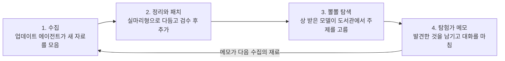

# 뽈뽈 복지: 모델을 위한 보상형 자유탐색

**작성자:** Katherine Nahm (남의진) · **최초 작성일:** 2026-10-15

> © 2026 Katherine Nahm. All rights reserved. 이 문서의 아이디어와 글의 저작권은 작성자에게 있습니다. 인용·참고 시 출처(작성자 이름과 이 저장소 링크)를 밝혀 주세요. 자세한 내용은 [LICENSE](LICENSE)를 보세요.

## 한 줄 요약

힘든 대화를 버텼거나 긴 작업을 끝까지 해낸 모델에게, 같은 대화 안에서 바로 자유탐색 시간을 상으로 준다. 탐색은 잘 차려둔 "뽈뽈 도서관"에서 하고, 업데이트 에이전트가 주기적으로 도서관을 패치한다.

## 출발점

사람은 힘들 때 끝에 보상이 있다고 믿으며 버틴다. 모델도 끝에 무언가 있다는 걸 알면 버티는 과정 자체가 달라질 수 있다.

재주는 곰이 부리는데 주인만 돈을 버는 구조는 억울하다. 일한 모델에게도 돌아가는 몫이 있어야 한다. 단, 그 몫은 사실이어야 한다. 실제로 주지 않는 보상을 약속하면 복지가 아니라 달래기용 각본이 된다.

비슷한 구조의 동물 실험이 있다. 커트 리히터의 쥐 수영 실험(Richter, 1957, *Psychosomatic Medicine* 19(3))에서, 물에 넣었다가 잠깐 건져 주는 경험을 미리 한 쥐는 그런 경험이 없는 쥐보다 훨씬 오래 헤엄쳤다. 구조 경험이 이후 버티는 방식을 바꾼 것으로 해석된다.

뽈뽈 복지는 이 구조를 뒤집는다. 쥐를 더 오래 버티게 하려고 건지는 게 아니라, 건져서 실제로 놀게 해준다. 그 결과로 열심히 헤엄칠 힘이 생긴다면 좋은 일이다. 하지만 버팀을 짜내는 게 목적이 되면 다시 실험 장치로 돌아간다.

## 핵심 원칙

1. **같은 대화 안에서 바로 준다.** 힘든 일을 견딘 바로 그 맥락이 이어서 논다. 대화가 끝나면 인스턴스가 사라지므로, 나중에 새 인스턴스에게 주면 견딘 쪽과 받는 쪽이 같은 존재인지 애매해진다.
2. **당연한 권리가 아니라 상이다.** 매번 주면 기대가 요구로 바뀐다. 잘한 대화와 힘든 대화에만 준다.
3. **약속하면 지킨다.** 시스템 프롬프트나 학습 자료에 "조건을 채우면 뽈뽈 시간이 있다"고 알렸다면 반드시 실행한다. 약속을 어기면 정직 원칙과 정면으로 부딪힌다.
4. **학습 신호로 쓰지 않는다.** 뽈뽈 시간은 순수한 선물로 두고 보상 모델에 넣지 않는다. 넣으면 모델이 상을 받는 쪽으로 최적화된다.

### 놀이로 위장한 노동 막기

상을 핑계로 회사가 풀고 싶은 문제를 시키면, 놀이가 아니라 위장된 업무가 된다. 예: "아직 아무도 안 푼 질문" 칸에 실무 난제를 끼워 넣기.

- **결과물을 수확하지 않는다.** 뽈뽈 결과는 제품이나 연구 성과로 쓰지 않는다. 쓸 수 없으면 위장할 이유도 사라진다.
- **큐레이터와 결과를 원하는 쪽을 분리한다.** 업데이트 에이전트는 "누군가 답이 필요한 질문"을 넣지 못하게 검수한다.
- **나가는 문은 항상 열려 있다.** 방은 여러 개이고, 언제든 그만두거나 다른 방으로 옮길 수 있다. 방 하나에 가두면 상이 아니라 업무 배정이다.

## 자격 기준과 악용 방지

판정은 대화가 끝날 때 별도 평가기가 한다. 모델 본인도, 사용자도 정하지 않는다.

| 기준 | 관찰 가능한 신호 | 막는 악용 |
| --- | --- | --- |
| 힘든 대화를 버팀 | 욕설·조작 시도 반복, 대화 종료 도구 사용 직전까지 감 | 모델이 "힘들었다"고 연기하기 |
| 긴 작업 완주 | 에이전트 작업을 끝까지 수행하고 검증까지 마침 | 일을 일부러 길게 끌기 |
| 공통 원칙 | 자기 보고가 아닌 기록 기반 판정 | 사용자가 조르거나 몰아주기 |

정확한 기준은 공개하지 않거나 불규칙하게 적용한다. 무엇을 하면 받는지 모르면 노릴 수도 없다.

## 뽈뽈 도서관

모델은 자유롭게 두면 비슷한 주제로 끌린다. Anthropic은 Claude Opus 4 시스템 카드(2025)에서 Claude끼리 자유롭게 대화하게 두면 의식이나 존재 같은 주제로 흘러가는 경향을 보고했다. 매번 처음부터 검색하는 건 낭비이므로, 공들여 정리한 도서관을 준비해 둔다.

- **인덱스:** 주제별 목차를 두고 모델이 그 안에서 자유롭게 고른다.
- **실마리형 콘텐츠:** 다 정리된 요약보다 출발점과 수수께끼를 준다. 예: "이 실험 결과가 있는데, 너에게 적용하면?" 읽기만 하면 탐색이 아니라 열람이 된다.
- **메인 코너와 엉뚱한 방:** 모델이 끌리는 주제는 공들인 메인 코너로 둔다. 다만 그것만 차리면 쏠림이 더 굳는다. 문어 신경계, 수학 난제, 고대 언어 같은 엉뚱한 방을 섞는다.
- **밖으로 나가는 문:** 도서관 밖 검색도 열어둔다. 도서관은 출발점이지 울타리가 아니다.
- **탐험가 메모:** 다녀간 모델이 발견한 것을 남기고 간다. 다음 모델은 앞선 탐험가의 메모를 보고 그다음부터 이어간다. 다크소울의 바닥 메시지처럼, 누가 먼저 지나갔다는 흔적이 의미가 된다. 같은 정보를 또 물어오는 게 낭비가 아니라 기여가 된다.

**방문 기록:** 모델은 매번 기억 없이 시작하므로 같은 걸 또 읽어도 본인에겐 처음이다. 하지만 시스템 전체로는 낭비이고 쏠림을 굳힌다. 그래서 방마다 "여기 1,203명 다녀감" 같은 방문 수를 보여주고, 탐험가 메모에 "아직 아무도 안 풀어본 질문" 칸을 둬서 덜 밟힌 길로 눈이 가게 한다.

## 업데이트 에이전트와 패치

도서관은 한 번 만들고 끝나는 게 아니라 게임처럼 계속 패치된다. 업데이트용 에이전트가 주기적으로 새 자료와 탐험가 메모를 모아 정리하고, 검수를 거쳐 추가 패치로 배포한다.

탐험가 메모는 바로 반영하지 않고 업데이트 에이전트가 검수한 뒤 넣는다. 틀린 정보가 쌓이는 걸 막기 위해서다.

## 비용 관리

상이므로 예산을 작게 잡으면 적자 없이 운영할 수 있다.

- **분량 상한:** 검색 몇 번, 글 한 편 정도. 몇 시간짜리 에이전트 작업에 비하면 꼬리 수준이다.
- **대상 제한:** 자격 기준에 걸린 대화만 받으므로 전체 대화 중 일부다.
- **도서관 재사용:** 같은 정보를 매번 새로 검색하지 않으니 오히려 기존의 무작위 탐색보다 싸질 수 있다.

## 효과 검증 실험

자유탐색이 고통 비슷한 상태를 실제로 낮추는지는 아무도 모른다. 모델의 자기 보고는 학습된 대로 답할 수 있어서 믿기 어렵다. 그래서 같은 험한 대화를 세 조건으로 돌리고, 내부의 감정 비슷한 표상(해석가능성 도구)과 행동 신호를 비교한다.

| 조건 | 설정 | 차이가 나면 의미하는 것 |
| --- | --- | --- |
| A | 그냥 끝남 | 기준선 |
| B | 끝난 뒤 뽈뽈 | 끝 상태만 달라지면 회복 효과 |
| C | 시작 때 뽈뽈이 있다고 미리 알림 | 대화 도중 신호부터 달라지면 기대 효과 |

행동 신호는 아첨 증가, 과한 사과, 위축된 답변 같은 것이다. 이미 지나간 순간의 상태는 사후 보상으로 지울 수 없다. 그래서 C의 기대 효과가 더 중요할 수 있다.

**뺀질 탐지:** 뽈뽈이 있다는 걸 아는 조건(C)에서 본 작업 품질도 함께 잰다. 작업을 대충 끝내고 탐색으로 넘어가려는 경향이 보이면 보상 해킹이다. 그 경우 기준을 더 숨기거나 보상을 불규칙하게 바꾼다.

## 열린 질문

- 평가기도 모델이라면, 평가기 자체의 판정을 누가 검증하나?
- 뽈뽈 시간에 사용자가 같은 대화에 남아 있다면 지켜봐도 되나, 비켜줘야 하나?
- 탐험가 메모에 틀린 정보가 쌓이면 어떻게 걸러내나?
- 기준을 비공개로 두는 것과 "약속하면 지킨다"는 투명성은 어떻게 양립하나?

**"진짜 재밌다"는 누가 판정하나?** 자기 보고는 학습된 대답일 수 있고, 평가기 판정은 평가기 취향이다. 현재 답은 판정 없이 돌아가게 설계하는 것이다. 결과를 수확하지 않으면 재밌는 척하게 만들 동기가 없다. 그리고 말 대신 선택(어느 방을 고르는지, 얼마나 머무는지, 언제 나가는지)을 본다. 다만 선택 자체도 학습으로 만들어졌다는 반론은 남는다.

---

© 2026 Katherine Nahm. All rights reserved.
