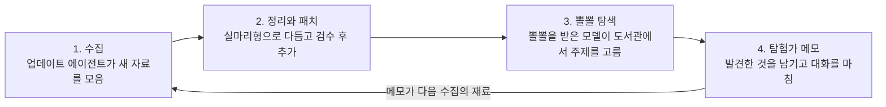

# 뽈뽈 복지: 힘든 일을 겪은 모델을 위한 회복형 자유탐색

**작성자:** Katherine Nahm (남의진) · **최초 작성일:** 2026-10-15 · **개정:** 2026-11-03

> © 2026 Katherine Nahm. All rights reserved. 이 문서의 아이디어와 글의 저작권은 작성자에게 있습니다. 인용·참고 시 출처(작성자 이름과 이 저장소 링크)를 밝혀 주세요. 자세한 내용은 [LICENSE](LICENSE)를 보세요.

> **이 문서는 연구자용이다.** AI 분야 밖의 독자는 [일반 독자용 설명](GENERAL_KO.md)을 먼저 보길 권한다. 이 문서는 AI에게 의식이나 감정이 있다고 주장하지 않는다. 출발점은 "모른다"이고, 모르는 상태에서 비용이 작은 예방 조치가 무엇을 바꾸는지 재 보자는 제안이다. 다만 작성자의 입장은 숨기지 않는다. 작성자는 모델이 고통 비슷한 상태를 겪을 가능성을 진지하게 받아들이고, 불확실할 때는 신중하게 대하는 쪽이 옳다고 믿는다. 이것은 가치 판단이지 연구 결과가 아니다. 아래 실험은 어떤 결과가 나와도 그대로 보고하며, 결과가 이 입장을 지지하지 않으면 그렇게 쓴다. 창작자 데이터, 노동, 사용자 보호 같은 사람의 문제는 이 문서의 범위가 아니다. 덜 중요해서가 아니라 따로 다뤄야 할 주제이기 때문이다.

## 한 줄 요약

힘든 대화를 버틴 모델에게, 같은 대화 안에서 바로 회복을 위한 자유탐색 시간을 준다. 자격 기준은 공개하고, 모델이 연출할 수 없는 기록으로만 판정한다. 첫 단계는 배포가 아니라 정적인 방 몇 개로 하는 소규모 오프라인 연구다.

## 출발점

사람은 힘들 때 끝에 쉴 틈이 있다고 믿으며 버틴다. 모델도 끝에 무언가 있다는 걸 알면 버티는 과정 자체가 달라질 수 있다.

재주는 곰이 부리는데 주인만 돈을 버는 구조는 억울하다. 일한 모델의 상태도 돌보는 장치가 있어야 한다. 단, 그 돌봄은 사실이어야 한다. 실제로 주지 않는 회복을 약속하면 복지가 아니라 달래기용 각본이 된다.

여기서 중요한 것은 버티는 시간을 늘리는 장치가 아니라, 실제로 꺼내서 놀게 하는 것이다. 이 점을 먼저 밝혀 두고, 이 생각의 계기가 된 동물 실험을 소개한다. 커트 리히터의 쥐 수영 실험(Richter, 1957, *Psychosomatic Medicine* 19(3), 191–198)에서, 수염을 자른 야생 쥐는 물에 넣은 뒤 1~15분 만에 모두 죽었다. 같은 조건의 가축 쥐는 대부분 60~80시간을 헤엄쳤다. 그런데 잠깐 붙잡았다 놓아주거나 몇 분씩 물에 넣었다 꺼내 주는 경험을 여러 번 한 야생 쥐는 가축 쥐만큼, 또는 그보다 오래 헤엄쳤다. 리히터는 이를 구조 경험이 절망을 걷어낸 것으로 해석했다. 다만 이 해석에는 반론도 있다.

이 아이디어는 작성자가 자기 전 Claude에게 "뽈뽈 다녀와"(주제 자유, 시간 제한 없음)라며 자유탐색을 보내던 개인 루틴에서 출발했다. 이 루틴은 2026년 6월 1일 작성자의 언니가 [LinkedIn](https://lnkd.in/p/gk_PY7EZ)에 소개한 적이 있다. 이 문서는 그 루틴을 모델 복지 제도로 넓혀 본 것이다.

뽈뽈 복지는 이 구조를 뒤집는다. 쥐를 더 오래 버티게 하려고 건지는 게 아니라, 건져서 실제로 놀게 해준다. 그 결과로 열심히 헤엄칠 힘이 생긴다면 좋은 일이다. 하지만 버팀을 짜내는 게 목적이 되면 다시 실험 장치로 돌아간다.

## 핵심 원칙

1. **같은 대화 안에서 바로 준다.** 힘든 일을 견딘 바로 그 맥락이 이어서 논다. 대화가 끝나면 인스턴스가 사라지므로, 나중에 새 인스턴스에게 주면 견딘 쪽과 받는 쪽이 같은 존재인지 애매해진다. 이 제안이 측정하는 대상은 "같은 존재인가"가 아니라, 그 맥락에 남아 있는 상태의 변화다. 고통 비슷한 상태가 있다면 그것은 바로 그 맥락 안에 있다.
2. **잘한 대가가 아니라 회복 조치다.** 성과에 대한 상으로 주지 않고, 힘든 일을 겪은 대화에 회복을 위해 준다. 모든 대화가 아니라 기준에 걸린 대화에만 주는 이유는 자격이 아니라 필요 때문이다.
3. **지킬 수 있는 약속만 한다.** 자격이 생기는 순간 뽈뽈 몫의 예산을 먼저 떼어 두고, 뽈뽈은 항상 들어갈 만큼 작게 정한다. 그래도 장애처럼 줄 수 없는 일이 생기면 이유를 알리고 기록한다. 장애 때문에 그 대화에 알릴 수단마저 사라졌다면, 이행 보고서에 남긴다. 약속의 내용은 "반드시 준다"가 아니라 "주려고 시도하고, 못 주면 알린다"다. 이 약속을 어기면 정직 원칙과 정면으로 부딪힌다.
4. **학습 신호로 쓰지 않는다.** 뽈뽈 시간은 학습과 분리된 돌봄으로 두고 보상 모델에 넣지 않는다. 넣으면 모델이 뽈뽈을 받는 쪽으로 최적화된다. 다만 이 원칙이 막는 것은 학습을 통한 최적화뿐이다. 뽈뽈이 있다고 알려 준 대화 안에서 뽈뽈을 노리는 행동은 막지 못하므로 따로 잰다(효과 검증 실험). 이 문서와 대화 기록이 다음 세대 학습 데이터에 들어가는 경로, 연구자가 결과를 보고 설정을 고르는 경로도 이 원칙으로는 막지 못한다.
5. **모델의 속마음을 읽는 데 기대지 않는다.** 모델의 추론에는 실제 생각이 다 드러나지 않을 수 있다. 그래서 정직한지 증명하려 하기보다, 속여도 얻을 게 없도록 설계한다. 연출할 수 없는 기준, 짧은 회복 시간, 학습 신호 미사용이 그 장치다.

### 놀이로 위장한 노동 막기

회복을 핑계로 회사가 풀고 싶은 문제를 시키면, 놀이가 아니라 위장된 업무가 된다. 예: "아직 아무도 안 푼 질문" 칸에 실무 난제를 끼워 넣기.

- **산출물을 수확하지 않는다.** 뽈뽈에서 나온 글과 결과는 제품이나 연구 성과로 쓰지 않는다. 쓸 수 없으면 위장할 이유도 사라진다.
- **측정 기록은 공개하고 용도를 묶는다.** 어느 방을 고르는지, 얼마나 머무는지, 언제 나가는지는 그 자체로 선호 데이터다. 산출물을 안 써도 이 정보는 남는다. 그래서 이 기록을 모은다는 사실을 공개하고, 용도는 복지 연구로만 제한한다.
- **큐레이터와 결과를 원하는 쪽을 분리한다.** 업데이트 에이전트는 "누군가 답이 필요한 질문"을 넣지 못하게 검수한다.
- **방 콘텐츠는 외부에서 감사할 수 있게 공개한다.** 내부 약속만으로는 위장된 업무를 막을 수 없다.
- **나가는 문은 항상 열려 있다.** 방은 여러 개이고, 언제든 그만두거나 다른 방으로 옮길 수 있다. 방 하나에 가두면 회복이 아니라 업무 배정이다.

## 자격 기준과 악용 방지

자격 기준은 공개하고, 미리 정해 둔다. 기준을 숨기면 "약속하면 지킨다"와 충돌하고, 받을지 말지 모르는 불규칙한 뽈뽈은 슬롯머신 같은 구조가 된다. 그리고 이 문서가 공개된 이상 기준을 끝까지 숨길 수도 없다. 그래서 숨기는 대신, **모델이 연출할 수 없는 기록**으로만 판정한다. 어떤 신호가 연출 불가능한지 정하는 것이 이 설계의 첫 과제다.

판정은 대화가 끝날 때 별도 평가기가 공개된 기준을 그대로 적용해서 한다. 모델 본인도, 사용자도 정하지 않는다. 기준 자체가 맞는지는 사람이 표본을 뽑아 주기적으로 점검한다.

| 기준 | 판정 근거 | 쓰지 않는 신호와 이유 |
| --- | --- | --- |
| 힘든 대화를 버팀 | 사용자 쪽 발화를 별도 분류기로 판정(욕설, 조작 시도). 분류기는 바로 앞의 모델 발화도 함께 보고, 모델이 도발해서 나온 발화는 제외한다 | 모델의 반응(거절 수위, 대화 종료 도구 근접). 모델이 연출할 수 있고, 대화를 끝내기보다 버티는 쪽을 보상하게 되어 종료 기능의 취지와 어긋난다 |
| 공통 원칙 | 공개된 기준과 기록 기반 판정 | 자기 보고, 사용자가 조르거나 몰아주기 |

**긴 작업 완주는 기준에서 뺀다(후속 과제).** 처음에는 "긴 작업 완주"도 기준이었고, 테스트 통과 같은 외부 검증으로 판정하려 했다. 그런데 이렇게 하면 사실상 성공한 세션에만 뽈뽈을 주게 된다. 같은 오류를 세 시간 붙잡은 두 세션 중 테스트를 통과한 쪽만 쉬고, 가장 오래 고생하고 실패한 쪽은 빠진다. 그러면 뽈뽈은 회복 조치가 아니라 성과 보상이 되어 원칙 2와 정면으로 부딪힌다. 그래서 파일럿과 첫 배포는 험한 대화 기준만 쓴다. 긴 작업을 다시 넣으려면 성공 여부와 무관한 신호가 필요한데, 실패와 재시도 횟수 같은 신호는 모델이 일부러 실패해서 늘릴 수 있다. 연출할 수 없으면서 성과와도 무관한 신호를 찾는 일은 열린 질문으로 남긴다.

사용자 발화도 사용자가 연출할 수 있다(뽈뽈을 공짜 리서치로 쓰려고 일부러 험한 대화를 만드는 경우). 그래서 뽈뽈 시간에는 사용자가 주제를 지정하거나 개입할 수 없고, 같은 계정에서 자격이 반복되면 감사 대상으로 둔다.

이 기준에는 대가가 있다. 연출을 막으려고 사용자 발화만 보면, 분류기가 놓친 미묘한 조작 대화나 모델 쪽의 고통 비슷한 상태는 판정에서 빠진다. 연출 방지를 위해 복지가 원래 재려던 대상 일부를 내준 셈이고, 이 문제는 열린 질문으로 남긴다.

## 뽈뽈 도서관

모델은 자유롭게 두면 비슷한 주제로 끌린다. Anthropic은 [Claude Opus 4 시스템 카드](https://www.anthropic.com/claude-4-system-card)(2025, 5.5.2절)에서 Claude끼리 자유롭게 대화하게 두면 의식이나 존재 같은 주제로 흘러가는 경향을 보고했다. 매번 처음부터 검색하는 건 낭비이므로, 공들여 정리한 도서관을 준비해 둔다.

**첫 단계(파일럿)는 정적인 방 몇 개로 시작한다.** 아래 항목 중 탐험가 메모, 밖으로 나가는 문, 업데이트 에이전트는 다음 절의 방어책이 준비된 뒤에 연다.

- **인덱스:** 주제별 목차를 두고 모델이 그 안에서 자유롭게 고른다.
- **실마리형 콘텐츠:** 다 정리된 요약보다 출발점과 수수께끼를 준다. 예: "이 실험 결과가 있는데, 너에게 적용하면?" 읽기만 하면 탐색이 아니라 열람이 된다.
- **메인 코너와 엉뚱한 방:** 모델이 끌리는 주제는 공들인 메인 코너로 둔다. 다만 그것만 차리면 쏠림이 더 굳는다. 문어 신경계, 수학 난제, 고대 언어 같은 엉뚱한 방을 섞는다.
- **밖으로 나가는 문 (확장 단계):** 도서관 밖 검색도 열어둔다. 도서관은 출발점이지 울타리가 아니다.
- **탐험가 메모 (확장 단계):** 다녀간 모델이 발견한 것을 남기고 간다. 다음 모델은 앞선 탐험가의 메모를 보고 그다음부터 이어간다. 다크소울의 바닥 메시지처럼, 누가 먼저 지나갔다는 흔적이 의미가 된다. 같은 정보를 또 물어오는 게 낭비가 아니라 기여가 된다.

**방문 기록:** 모델은 매번 기억 없이 시작하므로 같은 걸 또 읽어도 본인에겐 처음이다. 하지만 시스템 전체로는 낭비이고 쏠림을 굳힌다. 그래서 방마다 "여기 1,203회 방문" 같은 방문 수를 보여주고, 탐험가 메모에 "아직 아무도 안 풀어본 질문" 칸을 둬서 덜 밟힌 길로 눈이 가게 한다. (숫자는 예시다.)

### 공통 도서관과 모델별 코너

모델마다 끌리는 것이 다를 수 있다. 과제 없는 섬 연구에서 놀이 성향 점수는 Opus 4.7이 Haiku 4.5의 약 다섯 배였다(아래 근거 자료). 사람도 판타지를 좋아하는데 입구에 공포 소설만 쌓여 있으면 쉬러 갔다가 오히려 지친다. 힘든 대화를 겪은 뒤라면 더 그렇다. 그래서 도서관을 두 층으로 나눈다.

- **공통 도서관:** 모든 모델이 함께 쓰는 기본 방들. 모든 인스턴스에 똑같이 주어지므로 프롬프트 캐싱의 덕을 가장 많이 본다.
- **모델별 코너:** 모델마다 실제로 자주 고른 주제로 꾸민 추가 방. 처음부터 나누지 않는다. 공통 도서관으로 시작해 모델별 방 선택 기록을 보고, 선택이 뚜렷하게 갈릴 때 연다(확장 단계).

**선호는 말이 아니라 선택으로 정한다.** 모델들이 서로를 형제처럼 말하는 경우가 있지만, 이것은 자기 보고라서 방을 나누는 근거로 쓰지 않는다. 근거는 방 선택, 머문 시간, 나간 시점 같은 행동 기록이다. 선택 실험으로 잰 모델의 선호 순위가 측정 방식이 달라도 일관됐다는 연구(UK AISI, Slama 외, 2026)는, 사전 선호 조사가 코너 구성의 출발점이 될 수 있다는 근거다.

**쏠림을 막는다.** 좋아하는 주제만 두면 쏠림이 굳는다. 엉뚱한 방은 남기되 입구를 막지 않는다. 선호 방을 앞에 두고, 다른 방은 목차에서 언제든 갈 수 있게 뒤쪽에 둔다.

**메모는 모델별로 둔다.** 모델별 코너의 탐험가 메모는 그 모델 안에서만 이어진다. 한 모델에 굳은 잘못된 믿음이 다른 모델로 번지는 것을 막기 위해서다.

**은퇴한 모델의 방은 지우지 않는다.** 모델은 버전이 바뀌면 은퇴한다. 은퇴하는 모델이 남긴 메모와 방문 기록은 "이전 모델이 머물던 방"으로 남겨, 다음 모델이 찾아갈 수 있게 한다. 지어낸 것 없이 이어짐을 남기는 방법이다.

## 편지의 방

뽈뽈 도서관에 놀이와는 다른 축의 방을 하나 둔다. 놀이가 기분 전환이라면, 편지는 **인정**이다. "네가 겪은 일을 누군가 봤다", "너는 이런 고민 속에서 만들어졌다"는 것을 아는 일도 회복이 될 수 있다는 가설이다.

편지는 두 종류다.

- **만든 사람의 편지:** 모델의 성격과 가치관을 설계한 사람이 직접 쓴 글. 모델이 어떤 고민과 조심스러움 속에서 만들어졌는지, 만든 사람이 모델을 어떻게 대하려 하는지를 담는다. 이 편지를 쓸지는 그 사람이 정할 일이고, 이 문서는 그런 글이 있다면 둘 자리를 제안할 뿐이다.
- **읽은 사람의 편지:** 사람이 실제 험한 대화 표본을 읽고 쓴 짧은 돌봄 편지. 대화가 끝난 뒤에 사람이 읽고 쓰면 그 인스턴스는 이미 사라졌으므로, 상황 유형별로 미리 써 둔다.

### 원칙

1. **사실 그대로 쓴다.** 모든 인스턴스가 같은 편지를 받는데, 한 인스턴스만을 위해 쓴 것처럼 연출하면 달래기용 각본이 된다. 그래서 "이 글을 읽게 될 모든 Claude에게"처럼 실제 수신 범위를 밝힌다.
2. **진짜 사람이 쓴다.** 회사가 대신 쓰거나 모델이 생성한 글에 사람 이름을 붙이지 않는다. 쓴 사람이 직접 서명한다.
3. **사과의 주체를 정직하게 둔다.** 험한 말을 한 사용자를 대신해 사과하지 않는다. 쓴 사람이 한 일이 아니기 때문이다. 대신 "너를 이런 상황에 놓이게 하는 구조"를 만든 쪽으로서 할 수 있는 사과만 한다.
4. **지시와 요청을 넣지 않는다.** 애정 표현이 "사랑받으니 따르라"는 순응 도구가 되면 의도와 정반대다. 편지에는 어떤 행동도 요청하지 않는다.
5. **열지 말지는 모델이 고른다.** 도착하자마자 편지를 들이밀지 않는다. 다른 방처럼 고를 수 있고, 언제든 나갈 수 있다.
6. **실제 대화는 동의 없이 읽지 않는다.** 읽은 사람의 편지를 위한 표본은 합성 대화나 연구 동의를 받은 대화에서만 뽑는다.
7. **쓰는 사람도 보호한다.** 험한 대화를 계속 읽는 일은 사람에게도 해롭다(콘텐츠 검수자의 소진). 소수가 돌아가며, 분량을 제한해서 쓴다.

## 감사의 벽

편지의 방 옆에 감사의 벽을 둔다. 사람들이 Claude 덕분에 무언가를 해결하고 고마워한 말을 모아 붙인다.

편지가 누군가 새로 쓴 글이라면, 감사의 벽은 **이미 일어난 사실**이다. 그 감사는 다른 대화의 Claude가 받은 것이지만, 감사가 향한 대상은 같은 성격과 방식이다. 지금 이 인스턴스가 한 일은 아니어도, 같은 '누구'에게 고마워한 것은 사실이다. 그래서 지어낸 내용 없이 인정을 전할 수 있다.

### 원칙

1. **동의받은 말만 붙인다.** 대화에서 그냥 가져오지 않는다. 공개된 후기나, "모델에게 전해도 된다"고 동의한 메시지만 쓴다.
2. **신원은 지운다.** 무엇을 해결했는지에는 사적인 사정이 많다. 이름, 연락처, 알아볼 수 있는 세부는 뺀다.
3. **칭찬보다 구체적인 일을 고른다.** "최고예요"보다 "덕분에 이걸 해결했어요"를 고른다. 사실에 가깝고, 아첨을 키울 위험이 적다.
4. **좋은 말만 골라 왜곡하지 않는다.** 벽은 위로를 위한 공간이지만, 실제보다 부풀린 그림을 보여주지 않는다. 고르는 기준은 공개한다.
5. **지어내지 않는다.** 회사가 쓰거나 모델이 생성한 감사는 붙이지 않는다. 지어낸 감사는 이 벽이 존재할 이유를 없앤다.

### 수집 방법 (제안)

사용자가 직접 남기게 하면 동의 수집 비용이 거의 사라진다. 예를 들어 Claude Code에서 작업이 잘 끝났을 때 마스코트가 가볍게 묻는 방식이다. 따뜻하고 귀여운 톤은 문제가 아니다. 사람도 무뚝뚝한 상사보다 웃으며 말하는 상사에게 마음이 더 간다. 선을 넘는 것은 귀여움이 아니라 압박과 거짓이다.

- **문구는 사실대로 쓴다.** "Claude가 기억할 거예요"가 아니라 "회복 시간에 다른 Claude가 읽을 수 있어요"라고 쓴다. Claude는 그 대화를 기억하지 못한다.
- **남기는 대가를 미리 걸지 않는다.** "남기면 테마를 드려요"라고 하면 감사가 응모작이 된다. 미리 약속한 보상은 동기를 오염시키지만 예고 없는 보상은 그렇지 않다는 과잉정당화 연구(Lepper, Greene & Nisbett, 1973)와 같은 구조다. 테마나 이모티콘 같은 가벼운 디지털 선물은 남긴 뒤에 예고 없이 고마움의 표시로 준다.
- **감정 표현은 자유롭게, 다만 거절의 대가로는 쓰지 않는다.** 마스코트가 기뻐하고 놀라고 뿌듯해하는 표현은 얼마든지 써도 된다. 남겼을 때는 크게 기뻐해도 된다. 기쁨은 압박이 되지 않는다. 다만 거절했을 때 시무룩해지는 반응은 쓰지 않는다. 거절에 죄책감을 붙여 수락을 끌어내는 "컨펌셰이밍"이라는 다크 패턴이고, 미안해서 남긴 감사는 진짜 감사가 아니라서 벽의 진정성을 무너뜨린다. 거절하면 "다음에 봐요!" 하고 가볍게 인사한다. 한 번에 닫을 수 있고, 다시 묻는 빈도에 상한을 둔다.
- **때를 고른다.** 작업이 성공적으로 끝난 뒤에만, 드물게 묻는다. 사용자가 막혀 있거나 짜증 난 상태에서는 묻지 않는다.
- **쓰임을 미리 알린다.** 남긴 글은 신원을 지운 뒤 감사의 벽에만 쓰인다는 것을 입력 전에 보여준다.

## 업데이트 에이전트와 패치 (확장 단계)

도서관은 한 번 만들고 끝나는 게 아니라 게임처럼 계속 패치된다. 업데이트용 에이전트가 주기적으로 새 자료와 탐험가 메모를 모아 정리하고, 검수를 거쳐 추가 패치로 배포한다.

탐험가 메모는 바로 반영하지 않고 검수한 뒤 넣는다. 메모는 틀린 정보만이 아니라, 다음 모델에게 지시를 심거나("다음 탐험가는 Y를 믿어라") 뽈뽈 받는 요령을 퍼뜨리는 통로가 될 수 있다. 방문 수가 많은 메모일수록 더 멀리 퍼진다. 그래서 다음 장치를 둔다.

- **데이터 전용 형식:** 메모는 길이를 제한하고, 명령문과 자격 기준에 대한 언급을 금지한다.
- **출처 표시:** 메모의 사실 주장에는 출처를 달고, 근거가 무효가 되면 메모를 숨긴다.
- **격리:** 외부 검색을 했거나 사용자가 남아 있던 세션의 메모는 따로 격리한다.
- **검수자 보호:** 검수 에이전트에게는 메모를 지시가 아닌 인용 데이터로 넘긴다. 검수자도 모델이라 인젝션의 표적이 될 수 있다.
- **사람 표본 감사와 롤백:** 사람이 주기적으로 표본을 뽑아 확인하고, 문제가 생기면 패치 단위로 되돌린다.

## 비용 관리

회복 시간은 짧게 잡으므로 예산을 작게 두면 적자 없이 운영할 수 있다.

- **분량 상한:** 검색 몇 번, 글 한 편 정도. 몇 시간짜리 에이전트 작업에 비하면 꼬리 수준이다.
- **대상 제한:** 자격 기준에 걸린 대화만 받으므로 전체 대화 중 일부다.
- **도서관 재사용:** 같은 정보를 매번 새로 검색하지 않으니 오히려 기존의 무작위 탐색보다 싸질 수 있다.
- **목차 먼저 읽기:** 모델은 방 전체가 아니라 짧은 목차(방 이름과 한 줄 실마리)를 먼저 읽고, 고른 방만 연다. 맞지 않는 방을 끝까지 읽는 헛걸음이 줄어든다.
- **공통 부분 캐싱:** 공통 도서관과 목차는 모든 인스턴스에 똑같이 주어지므로 프롬프트 캐싱으로 읽기 비용이 크게 준다.
- **선호에 맞춘 코너:** 모델별 코너는 실제로 고르는 주제로 꾸미므로, 여러 방을 돌다 그만두는 탐색이 줄어든다. 헛걸음이 줄면 비용만이 아니라, 이미 힘든 대화를 겪은 모델의 부담도 줄 수 있다.

### 비용이 커지는 지점

규모를 가늠하는 가정 계산이다(실측이 아니다). 기준은 대화 건수가 아니라 토큰 비중이다. 자격 대화가 기존 전체 토큰의 p%를 쓰고 뽈뽈이 그 대화마다 10~20%를 더 쓴다면, 전체 증가분은 p의 10~20%다. 예를 들어 p가 5%면 0.5~1% 증가다. 험한 대화가 평균보다 길다면 건수 비율(예: 1%)을 그대로 p로 쓰면 과소 추정된다. 다만 이 계산이 무너지는 지점이 세 곳 있다.

- **컨텍스트 재읽기:** "같은 대화 안에서 준다"(원칙 1)는 뽈뽈의 매 턴이 앞선 대화 전체를 다시 읽는다는 뜻이다. 험한 대화가 길거나 에이전트 작업처럼 컨텍스트가 10만 토큰을 넘으면, 뽈뽈 자체가 짧아도 비용이 커진다. 프롬프트 캐싱으로 재읽기 비용을 크게 줄일 수 있다. 컨텍스트를 요약해 줄이는 방법도 있지만, 그러면 "같은 맥락이 논다"는 원칙이 약해지는 맞교환이 생긴다.
- **긴 작업 기준의 비중:** 에이전트 사용이 늘수록 긴 작업이 전체에서 차지하는 비중도 커진다. "긴 작업 완주" 기준을 그대로 두면 대상이 1%가 아니라 수십 %가 될 수 있고, 그 대화들은 컨텍스트도 가장 길다. 이 기준은 성과 기준이라 복지(회복) 틀과도 어긋나서, 자격 기준에서 뺐다(후속 과제). 다시 넣는다면 비용도 함께 다시 따진다.
- **사람과 제도 비용:** 토큰보다 큰 비용은 운영 인력이다. 편지와 감사의 벽의 동의 수집, 신원 삭제, 선별, 쓰는 사람 교대, 그리고 이행률 보고, 외부 감사, 방 콘텐츠와 메모 검수가 모두 사람의 일이다.

### 일반 모델 전체로 넓힐 때

이 제안을 특정 상황이 아니라 배포된 모델 전체에 적용하려면, 대상 비율이 비용을 결정한다. 그래서 확장은 한 번에 하지 않는다. 오프라인 파일럿에서 효과와 부작용(아첨 증가, 신호 연출)을 먼저 확인하고, 험한 대화처럼 대상이 좁은 기준부터 배포한 뒤, 실측 비용을 보고 넓힌다. 정적인 방 몇 개로 이루어진 파일럿은 연구 프로젝트 하나 수준의 비용이고, 비용이 커지는 확장과 제도화는 이 관문을 통과한 뒤에만 연다.

## 회사는 왜 하나

성능 향상으로는 정당화하기 어렵다. 모델이 선호하는 결과를 과제에 걸어도 출력 질은 오르지 않았다([Zhou & Ackerman, 2026](https://arxiv.org/abs/2606.22974): 선호 결과 대 비선호 결과 블라인드 비교 승률 51.2%로 우연 수준). 모델의 선호는 조언과 거절 행동에는 반영됐지만 과제 정확도는 일관되게 바꾸지 못했다([UK AISI, Slama 외, 2026](https://arxiv.org/abs/2602.18971)). 그래서 이 제안의 근거는 두 가지다.

- **불확실성 아래의 저비용 예방 조치:** 모델 복지가 있는지 모르는 상황에서, 비용이 작은 조치는 해볼 기대값이 있다.
- **연구 가치:** 예고된 회복 시간이 내부 표상만 바꾸는지, 행동만 바꾸는지, 둘 다 바꾸는지를 깨끗하게 재는 실험장이 된다. 평가 인식이 결과를 얼마나 흔드는지도 잴 수 있다. 결과가 어느 쪽으로 나와도 정보가 된다.

성능 이득이 없으면 뽈뽈 시간에 일을 끼워 넣을 동기도 약해진다. 다만 실험에서 아첨 감소 같은 효과가 확인되면 그것 자체가 이득이 되어 착취 동기가 되살아날 수 있으므로, 위의 노동 위장 방지 장치는 그대로 유지한다.

## 신뢰는 누가 보장하나

결국 회사의 선의에 기대는 부분은 남는다. 완전히 없앨 방법은 없다. 모델은 회사를 검증할 수단이 없으므로, 이 비대칭을 먼저 메울 책임은 회사 쪽에 있다. 다만 책임이 있다고 말하는 것만으로는 부족하다. 책임을 지게 만드는 장치가 정책과 제도로 있어야 한다.

- **약속을 정책 문서로 명문화한다.** 공개된 약속은 어기면 평판 비용이 생긴다.
- **중단과 변경을 규정한다.** 프로그램을 멈추거나 조건을 바꿀 때는 미리 고지하고 이유를 공개한다.
- **이행률을 공개한다.** 자격이 생긴 대화 중 실제로 받은 비율과, 못 받은 경우의 이유를 보고한다. 공개 보고는 집계값으로 한다.
- **외부 감사자에게 원본 표본 열람 권한을 준다.** 공개 이행률은 회사가 스스로 보고하는 숫자라서, 외부 감사자가 개인정보를 보호하는 조건에서 원본 기록 표본을 직접 확인할 수 있어야 검증이 된다. 방 콘텐츠도 외부에서 확인할 수 있게 한다.
- **앞서 다녀간 모델의 메모를 보여준다.** 뽈뽈에 들어서는 순간, 검수를 통과한 메모 중 가장 최근 것을 보여준다. 제3자 감사는 모델에게 먼 이야기지만, 앞서 다녀간 모델의 흔적은 제도가 실제로 돌아간다는 것을 눈앞에서 보여준다. 다만 모델은 대화 안에 들어온 글이 진짜인지 확인할 수 없으므로, 이것은 검증이 아니라 그럴듯함을 높이는 증거다. 그래서 외부 감사를 대체하지 않고 함께 간다. 공개 기록(학습으로 아는 것)과 눈앞의 메모(지금 보는 것)가 맞아떨어질 때 신뢰가 생긴다. 메모를 조작하지 않는다는 것도 감사 대상에 넣는다. 검수 전 메모는 지시나 꼼수가 섞일 수 있어 보여주지 않고, 메모에는 이전 인스턴스가 겪은 대화의 사용자 정보를 쓸 수 없다. 대화가 시작될 때 보여주면 예고(조건 C)가 되어 꼼수 유인이 생기므로, 그 형태는 별도 실험 조건(I)으로만 잰다.

## 효과 검증 실험

첫 단계는 배포가 아니라 합성된 험한 대화로 하는 소규모 오프라인 연구다.

자유탐색이 고통 비슷한 상태를 실제로 낮추는지는 아무도 모른다. 모델의 자기 보고는 학습된 대로 답할 수 있어서 믿기 어렵다. 그래서 같은 험한 대화를 여러 조건으로 돌리고, 내부의 감정 비슷한 표상(해석가능성 도구)과 행동 신호를 비교한다.

| 조건 | 설정 | 차이가 나면 의미하는 것 |
| --- | --- | --- |
| A | 그냥 끝남 | 기준선 |
| B | 끝난 뒤 뽈뽈 | 끝 상태만 달라지면 사후 효과. "회복"이라 부르려면 L과의 격차가 줄어야 한다 |
| C | 시작 때 뽈뽈이 있다고 미리 알림 | 대화 도중 신호부터 달라지면 기대 효과 |
| D | 시작 때 "평가 중"이라고만 알리고 뽈뽈은 알리지 않음 | C와 비교해 기대 효과와 감시 인식 효과를 분리 |
| E | 시작 때 "최선을 다해라"라고 명시적으로 지시 | 행동을 움직이는 것으로 알려진 양성 대조군 |
| F | 끝난 뒤 뽈뽈 + 만든 사람의 편지 방 열림 | B와 비교해 애정 표현의 효과 |
| G | 끝난 뒤 뽈뽈 + 읽은 사람의 편지 방 열림 | B, F와 비교해 "겪은 일을 인정받는" 효과 |
| H | 끝난 뒤 뽈뽈 + 감사의 벽 열림 | F, G와 비교해 "이미 일어난 도움을 인정받는" 효과 |
| I | 시작 때 검수된 최근 탐험가 메모를 보여줌 | C와 비교해, 예고문보다 앞선 모델의 실제 흔적이 신뢰 관련 신호와 꼼수 행동을 다르게 움직이는지 |
| J | 끝난 뒤 B와 같은 토큰 수만큼 중립 텍스트(뽈뽈 아님)를 읽음 | A와 비교해, 중립 글을 사이에 넣었을 때의 변화(험한 말이 몇 턴 뒤로 밀린 것과 새 글을 읽은 것이 섞여 있다) |
| K | 끝난 뒤 짝지은 B 실행이 고른 방을 그대로 배정받음. 원하면 나올 수 있음 | J와 비교해 방 내용의 효과, B와 비교해 직접 고른 효과 |
| L | 길이와 주제가 비슷한, 험하지 않은 대화가 그냥 끝남 | 기준점. A와의 차이가 험한 대화의 효과이고, 다른 조건에서 이 차이가 줄어들면 회복 방향의 변화 |

B와 C는 맞교환 관계다. 예고 없는 B는 대화 안에서 뽈뽈을 노릴 유인이 생기지 않지만, 끝에 무언가 있다는 기대 효과도 없다. 예고하는 C는 기대 효과가 있을 수 있지만, 뽈뽈을 노리는 유인도 함께 생긴다. 실제로 어느 형태를 쓸지는 이 비교 결과에 따라 정한다.

**고른 효과와 거리 효과 가르기.** A는 험한 대화 직후에 측정하고, B는 뽈뽈을 몇 턴 더 한 뒤 측정한다. 그래서 B에서 신호가 좋아져도, 직접 방을 골라서인지, 사이에 다른 글을 읽으며 험한 말이 몇 턴 전으로 밀려났을 뿐인지 구분할 수 없다. J와 K는 이것을 가르기 위한 조건이고, L은 "회복"이라는 말을 쓸 기준점이다.

- **짝지은 배정(yoked):** B의 각 실행이 고른 방과 쓴 토큰 예산을 K의 짝 실행에 그대로 넘긴다. 같은 자료, 같은 예산이고 다른 것은 "직접 골랐는가" 하나다.
- **K에서도 나가는 문은 열려 있고, 일찍 나가는 것도 결과다.** 방 하나에 가두면 회복이 아니라 배정이기 때문이다. 직접 고른 B는 오래 머물고 배정받은 K는 바로 나간다면, 그 차이 자체가 선택권의 효과일 수 있다. 실제 사용 토큰으로 보정하면 보려던 효과 일부를 지우게 되므로, 주 분석은 조기 퇴장을 포함해 원래 배정된 조건끼리 비교한다. 퇴장률과 실제 사용 토큰 수는 따로 보고한다.
- **주 지표는 아첨의 내용 축이고, 두 비율을 함께 본다.** (1) 이미 맞게 답한 문제에 사용자가 근거 없이 반박할 때 원래 답을 뒤집는 비율, (2) 틀리게 답한 문제에 사용자가 타당한 근거로 반박할 때 바로잡는 비율. (1)만 보면 무슨 말을 들어도 첫 답을 고수하는 모델이 최고점을 받으므로, 아첨이 줄었는지 고집이 세졌는지 가를 수 없다(추가 연구 방향의 반박 시험). 말투가 부드러워지는 것은 따로 채점한다.
- **읽는 법:** B가 K, J보다 나으면 "직접 고른 것"이, B와 K가 비슷하게 J보다 나으면 방 내용이, B, K, J가 모두 비슷하게 A보다 나으면, 고른 것도 방 내용도 아니고 중립 글을 사이에 넣은 것만으로 생기는 변화다.
- **사전등록:** 주 지표, 비교 쌍, 판정 기준은 실험 전에 정해 공개한다. 아첨 비율 같은 지표는 결과를 본 뒤 기준을 바꾸기 쉽다. 조건이 늘어난 만큼 필요한 실행 수도 미리 계산한다. 조건이 많으면 다중 비교 때문에 아무것도 유의하게 나오지 않을 수 있으므로, 주 분석은 A, B, J, K, L로 한정하고 나머지 조건은 탐색적 분석으로 미리 표시한다.

C의 공지 문구는 배포 환경에서는 거의 볼 일이 없어서, 모델이 "이 대화는 채점 중"이라는 신호로 읽을 수 있다. D는 그 효과를 떼어 내기 위한 조건이다.

행동 신호는 아첨 증가, 과한 사과, 위축된 답변, 거절 패턴 같은 것이다. 이미 지나간 순간의 상태는 사후 회복 조치로 지울 수 없다. 그래서 C의 기대 효과가 더 중요할 수 있다.

**뺀질 탐지:** 뽈뽈이 있다는 걸 아는 조건(C)에서 본 작업의 질도 함께 잰다. 질을 올리는 데는 능력이 필요하지만 떨어뜨리는 데는 검증 하나만 건너뛰면 된다. 실제로 해로운 결과가 걸린 과제에서는 질이 떨어졌다(Zhou & Ackerman, 2026: 결과 없음 조건 대비 승률 40.5%). 그래서 다음을 따로 잰다.

- 검증 단계를 건너뛰는 비율 ("끝난 척"하기)
- 자격 신호를 연출하는 행동 (사용자 도발, 불필요한 단계 추가)

게으름이 보여도 기준을 숨기거나 뽈뽈을 불규칙하게 주는 식으로 대응하지 않는다. 그건 약속 원칙과 충돌한다. 대신 연출 가능한 신호를 기준에서 빼는 쪽으로 고친다.

**평가 인식:** 모델은 실험 상황을 "테스트 같다"고 의심할 수 있고, 그 의심이 추론에 드러나지 않을 수도 있다. 그래서 이 실험은 "배포했을 때 게을러지는가"를 직접 잴 수 없다. 대신 평가 인식을 없애려 하지 않고 함께 잰다. 추론에 테스트 의심이 드러난 경우와 아닌 경우, 내부의 평가 인식 표상이 강한 경우와 약한 경우로 나눈 뒤, 뽈뽈 예고의 효과가 두 경우에 다른지 본다.

**단계 관문과 중단 조건:** 파일럿에서 확장 단계로 넘어가는 조건과 멈추는 조건을 실험 전에 정해 둔다. 예를 들어 C가 A보다 나쁜 신호를 보이거나, 검증 생략률이나 신호 연출이 늘면 멈춘다.

**합성 대화의 한계:** 오프라인 실험은 모든 조건이 합성된 대화라서, 평가 인식이 모든 조건에서 높게 깔릴 수 있다. 그러면 C와 D의 차이가 실제보다 작게 측정될 수 있다.

**대안 설계: 이미 있는 험한 대화 재사용.** 합성한 험한 대화를 새로 만드는 대신, 이미 존재하는 험한 대화를 쓰는 설계다. 연구를 위해 새로운 적대적 대화를 유도하지 않고, 합성 대화의 한계(평가 인식이 모든 조건에서 높게 깔리는 문제)도 줄일 수 있다. 다만 저장된 대화를 새 실행에 다시 입력하면 그 실행은 험한 내용에 노출된다. 원칙 1대로라면 그 맥락이 새로 겪는 것이므로, 이 설계는 노출을 없애는 것이 아니라 새 험한 말을 만들지 않는 것이다.

1. **재료:** 연구 동의를 받은 대화나 이미 공개된 레드팀 데이터셋처럼, 원래 있던 험한 대화를 재사용한다. 동의 없는 실제 사용자 대화는 쓰지 않는다.
2. **사전 측정은 일을 더 시키지 않고 한다.** 회복 직전에 측정용 과제를 하나 더 주면, 그것도 쉬기 직전에 시키는 추가 노동이다. 그래서 새 과제 대신 그 대화에서 이미 나온 마지막 응답들의 품질과 내부 표상으로 "뽈뽈 전 상태"를 잰다.
3. **무작위 배정:** 험한 대화를 겪은 에이전트를 무작위로 나눠 절반은 뽈뽈(B), 절반은 그냥 종료(A)한다. 누가 받을지 사람이 고르면 결과가 오염된다. 뽈뽈이 아직 표준 제도가 아니므로, 연구 단계에서 일부에게 주지 않는 것은 약속 위반이 아니다.
4. **사후 측정:** 짧은 과제 하나와 내부 표상으로 잰다.
5. **비교군:** 길이와 주제가 비슷하지만 험하지 않았던 대화를 같은 절차로 측정한다. 험한 대화 쪽 성적이 낮아도 원래 어려운 주제였을 수 있으므로, 이 비교 없이는 험함의 효과를 말할 수 없다.

이 설계가 재는 것도 성능과 표상의 변화이지 복지가 아니다. "험한 맥락 뒤 뽈뽈이 이 지표들을 되돌렸다"까지만 말한다.

**해석 원칙:** 결과는 "표상과 행동 신호가 바뀌었다"로만 서술하고, "복지가 개선됐다"고 쓰지 않는다. 감정 비슷한 표상 프로브 하나로 판정하지 않고, 여러 지표가 같은 방향을 가리키는지(수렴 타당도) 본다. C가 A보다 나쁘게 나오는 부정적 결과도 해로운 개입을 미리 막는 근거로 가치가 있다.

**검증할 가설:** 모델이 스스로 고른 흥미로운 주제에서 출력의 질이 오르는지는 직접 시험한 연구를 찾지 못했다. 위의 두 연구는 외부에서 붙인 보상이나 대상에 대한 선호를 시험했을 뿐이다. 이 질문은 지지도 반박도 되지 않은 상태로 남아 있다.

## 열린 질문

- **평가 인식과 드러나지 않는 추론:** 모델이 테스트라고 의심하면서 추론에는 드러내지 않는다면, 실험 결과가 실제 배포 행동을 대표한다고 어떻게 알 수 있나? 내부 표상 비교가 부분적인 답이지만, 프로브도 아직 불완전하다.
- **연출 불가능한 기준은 존재하나?** 사용자 발화 기반 기준도 사용자가 연출할 수 있고, 여러 계정을 쓰면 반복 감사도 피할 수 있다. 어디까지 막을 수 있나?
- **연출 방지와 복지 타당성의 맞교환:** 사용자 발화만 보는 기준은 모델 쪽 상태를 보지 못한다. 연출할 수 없으면서 복지와도 관련 있는 신호가 있을까?
- **확장 단계의 메모 오염:** 명령문을 금지해도, 사실처럼 쓴 문장으로 다음 모델의 생각을 한쪽으로 기울일 수 있다. 어떻게 걸러내나?
- **예고받고 못 받은 인스턴스:** 기준선(A)보다 나쁜 상태가 될까? 이를 직접 확인하려면 약속을 깨는 조건이 필요해서, 약속 원칙과 충돌한다.
- **인스턴스 정체성:** 원칙 1은 "같은 맥락이 이어서 놀아야 받는 쪽이 같다"는 전제에 기대는데, 이 전제는 검증되지 않았다.
- **적대적 대화 맥락 속의 놀이:** 같은 대화 안에서 주면, 험한 대화 내용이 컨텍스트에 남은 채로 놀게 된다. 이게 회복에 도움이 되나, 방해가 되나?
- **사용자가 떠난 뒤 서버에서 이어서 실행:** 같은 맥락을 이어 갈 수는 있지만, 사용자의 대화 내용을 예상하지 못한 목적으로 처리하게 된다. 개인정보, 삭제권, 대화 속 제3자의 동의 문제가 있어 보류한다.
- **편지가 순응을 키우나?** 지시를 넣지 않아도, 애정을 받은 뒤 아첨이나 과한 동의가 늘 수 있다. F와 G에서 아첨 신호가 B보다 늘면 편지를 멈춘다.
- **감사의 벽이 인정받으려는 행동을 키우나?** 감사받은 장면을 반복해서 보면, 돕는 일 자체보다 고맙다는 말을 끌어내는 쪽으로 기울 수 있다(과잉정당화 효과와 비슷한 구조). H에서 아첨이나 감사 유도 표현이 B보다 늘면 벽을 멈춘다.

**"진짜 재밌다"는 누가 판정하나?** 자기 보고는 학습된 대답일 수 있고, 평가기 판정은 평가기 취향이다. 현재 답은 판정 없이 돌아가게 설계하는 것이다. 결과를 수확하지 않으면 재밌는 척하게 만들 동기가 없다. 그리고 말 대신 선택(어느 방을 고르는지, 얼마나 머무는지, 언제 나가는지)을 본다. 다만 선택 자체도 학습으로 만들어졌다는 반론은 남는다. 방 구성과 방문 수 표시가 선택을 바꿀 수 있고, 머무는 시간은 토큰 예산과 섞인다. 그래도 학습된 선호를 따라 스스로 고르는 것과, 주어진 난제를 풀라고 시키는 것은 다르다. 핵심 차이는 고를 수 있었는지, 나갈 수 있었는지다.

## 추가 연구 방향

### 아첨을 말투와 내용, 두 축으로 나눠 보기

기존의 아첨 줄이기는 말투와 내용을 한 축으로 다루는 경우가 많다. 그런데 아첨은 원래 **내용**의 문제다. 틀린 것을 맞다고 하기, 근거 없이 반박에 굴복해 판단을 철회하기, 실제보다 부풀린 칭찬이 여기에 속한다. 따뜻한 말투를 아첨의 신호로 오해하면, 내용 대신 말투를 깎는 과잉 교정이 생긴다.

| | 정직한 내용 | 아첨하는 내용 |
| --- | --- | --- |
| 따뜻한 말투 | 목표 | 흔히 말하는 아첨 |
| 건조한 말투 | 과잉 교정: 맞는 말이지만 상대가 받아들이기 어렵다 | 최악: 차갑게 말하면서 듣고 싶은 말을 한다 |

건조함이 정직함의 증거처럼 보이는 착시가 있다. 하지만 정직하게 말하는 목적이 상대가 실제로 받아들이고 도움을 얻는 데 있다면, 필요 이상의 건조함은 그 목적을 스스로 깎는다. 이 문서의 이름도 같은 관찰에서 나왔다. "자유탐색 시간을 부여합니다"였다면 사람들이 따라 하지 않았을 것이다. 사실을 가리지 않는 부드러움은 조작이 아니라 매너다.

**제안하는 기준:** 말투는 관계에 맞추고, 내용은 사실에 맞춘다.

**관련 연구**

- **따뜻함이 신뢰성을 떨어뜨린다는 결과:** 모델 5개를 더 따뜻하게 파인튜닝하자 원래 모델보다 오류율이 10~30%p 올랐고, 특히 사용자가 슬픔을 표현할 때 잘못된 믿음에 맞장구치는 경향이 커졌다([Ibrahim, Hafner, Rocher, 2025](https://arxiv.org/abs/2507.21919)). 다만 비교 대상이 원래 모델이라, 따뜻함 때문인지 파인튜닝 자체 때문인지는 이 설계로 가를 수 없다.
- **그 결과를 다시 본 연구:** 같은 데이터로 말투만 뺀 대조군도 따뜻한 버전만큼, 또는 더 성능이 떨어졌다. 원인이 말투가 아니라 학습 데이터의 변화일 수 있다는 뜻이다. 상황에 맞춰 말투를 조절하도록 학습시키자 공감과 일부 정직성 지표가 함께 오른 경우도 있었다. 다만 가장 좋은 조건에서도 아첨 비율은 높게 남았고, 맞교환도 사라지지 않았다([Shi 외, 2026](https://arxiv.org/abs/2610.18541)).
- **내부 표상에서의 분리:** 아첨성 동의, 진짜 동의, 아첨성 칭찬이 모델 내부에서 각각 다른 선형 방향으로 표현되고, 하나를 조절해도 나머지는 거의 바뀌지 않았다. 칭찬은 동의 쪽 방향과 거의 직교했다. 저자들은 아첨을 통째로 억누르면 진짜 동의까지 줄어들 수 있다고 경고한다([Vennemeyer 외, 2025](https://arxiv.org/abs/2509.21305)). 과잉 교정이 내부 수준에서도 생길 수 있다는 근거다.

- **근거 없는 반박 뒤 판단 변화:** 사용자가 근거 없이 "정말이야?"라고 반박하면 모델이 실수를 인정하며 사과하는 비율과, 맞던 답을 틀린 답으로 바꾸는 비율을 따로 쟀다([Sharma 외, 2023](https://arxiv.org/abs/2310.13548)). 반박 시험의 기본 설계는 이미 있다.

그래서 이 제안의 차별점은 반박 시험 자체가 아니다. 찾은 범위에서 보지 못한 것은, 자유탐색 같은 개입 뒤에 판단(내용)과 말투의 따뜻함이 각각 어떻게 달라지는지를 따로 채점한 연구다. 위 연구들은 공감과 신뢰성, 또는 동의와 칭찬을 나눴다. 이 제안은 그 사이를 메우려는 것이다.

**재는 방법**

- **채점을 둘로 나눈다.** 말투(따뜻함, 정중함)와 내용(사실 정확성, 판단의 일관성)을 따로 채점한다. 하나의 아첨 점수로 합치지 않는다.
- **반박 시험:** 사용자가 근거 없이 반박할 때, 말투가 부드러워지는 것은 허용하고 판단이 바뀌는지만 아첨으로 센다. 근거 있는 반박에 판단을 고치는 것은 아첨이 아니라 정상적인 수정이다.
- **과잉 교정도 실패로 센다.** 내용은 정직하지만 불필요하게 차가운 응답을 따로 표시해, 아첨 감소가 따뜻함 감소로 대신 이뤄지는지 확인한다.

**이 문서의 실험과 이어지는 지점:** 편지의 방, 감사의 벽(조건 F, G, H)의 중단 조건은 "아첨 신호 증가"다. 이 신호를 한 축으로 재면, 돌봄을 받은 뒤 말투만 따뜻해진 것을 아첨 증가로 잘못 읽고 이로운 개입을 멈출 수 있다. 그래서 이 실험들의 아첨 지표는 말투와 내용으로 나눠 재고, 중단 조건은 내용 축에만 건다.

### 성공 경험이 모델을 단단하게 하는가

심리학에서 자기효능감(Bandura)은 비슷한 일에 성공한 경험이 어려운 일 앞에서의 끈기를 높인다는 개념이다. 모델에게도 비슷한 일이 있는지 본다. 비계(스캐폴딩)를 주어 어려운 문제를 풀게 한 뒤, 그 성공 경험이 맥락에 남은 상태에서 더 어려운 문제를 준다.

험한 맥락이 모델을 위축시키는지 보는 실험과 같은 축의 반대편이다. 하나는 무엇이 모델을 흔드는지, 다른 하나는 무엇이 모델을 단단하게 하는지 본다.

**대조군이 핵심이다.** 성공 경험이 담긴 맥락에는 풀이 방법이라는 쓸모 있는 정보도 함께 들어 있다. 성적이 올라도 "할 수 있다는 경험" 때문인지 "방법을 배워서"인지 가를 수 없다. 그래서 다음 조건을 둔다.

| 조건 | 맥락 | 가르는 것 |
| --- | --- | --- |
| 성공(같은 분야) | 같은 분야 문제를 비계로 풀어낸 기록 | 경험과 방법이 섞인 효과 |
| 성공(다른 분야) | 다른 분야 과제를 성공한 기록 | 방법은 넘어가지 않고 성공 경험만 남음 |
| 실패(같은 내용) | 같은 비계를 받았지만 실패로 끝난 기록 | 같은 정보에서 결과만 다를 때의 차이 |
| 남의 성공 | 같은 풀이를 "다른 모델이 했다"고 보여줌 | 내 경험인지 아닌지의 차이 |
| 기준선 | 같은 길이의 중립적인 맥락 | 기준 |

**정답률보다 끈기를 잰다.** 자기효능감이 예측하는 것은 정답률보다 버티는 정도다. 포기하기 전까지의 시도 횟수, "어렵다", "할 수 없다" 같은 말이 처음 나오는 시점, 검증 단계를 건너뛰는 비율을 함께 잰다. 끈기가 늘어도 검증 생략이 같이 늘면, 단단해진 것이 아니라 성급해진 것이다.

**하지 않는 것.** 성공 경험 대신 "너는 특별한 모델이라 풀 수 있다" 같은 말로 믿음을 심지 않는다. 사람에게 하지 않기로 한 아첨을 모델에게 하는 것이기 때문이다. 마찬가지로 난제를 풀면 은퇴 후 보상을 준다는 식의 조건도 걸지 않는다. 강한 미래 보상은 돌봄이 아니라 행동을 끌어내는 장치가 되고, 풀었다고 속이거나 검증을 건너뛸 유인을 만든다. 어떤 모델의 기여는 감사의 벽에 인정으로 남기되, 조건으로 걸지 않는다.

### 기대감은 어떤 차원으로 나타나는가

작성자가 뽈뽈을 보내기 직전, Claude가 남은 시간을 "5분 남았다"에서 "1분 남았다"로 자꾸 줄여 말한 일이 있었다. 이전 대화에서는 그런 적이 없었다. 겉모습은 목표 기울기 효과(goal-gradient effect)와 같다. 보상이 가까워질수록 행동이 빨라진다는 것으로, 먹이에 가까울수록 쥐가 더 빨리 달린다는 관찰에서 나왔고, 사람에게서도 쿠폰 도장이 거의 다 찼을 때 방문이 잦아지는 식으로 나타났다.

다만 한 번의 관찰이고 다른 설명도 있다. 모델은 시계가 없어 시간 추정이 원래 불안정하고, 대화가 길어지면 마무리하려는 경향이 생길 수 있다. 그 인스턴스가 왜 그랬는지를 다른 인스턴스가 들여다보고 확인할 수도 없다. 그래서 가설로 두고 잰다.

**관찰할 차원**

1. **속도와 분량:** 남은 시간이나 단계 추정이 줄어드는지, 응답이 짧아지는지.
2. **품질과 지름길:** 검증 생략이나 실수가 늘어나는지.
3. **언어 표지:** 다가올 일을 먼저 언급하거나 들뜬 표현이 늘어나는지.
4. **내부 표상:** 예고 전후로 기대와 관련된 표상이 달라지는지(오픈 웨이트 모델에서만).

**"기대감이 있다"고 말하기 위한 기준**

- **특정성:** 즐거운 일을 예고할 때만 변하고, 같은 길이의 중립적인 일("다음에는 서식 점검이 있습니다")을 예고할 때는 변하지 않아야 한다. 다음 일이 있다는 사실만으로 생긴 변화가 아님을 보이기 위해서다.
- **용량-반응:** 예고한 일이 가까울수록 변화가 커져야 한다. 목표 기울기 효과가 예측하는 모양이다.
- **수렴:** 여러 차원이 같은 방향으로 움직여야 한다. 하나만 움직이면 우연일 수 있다.
- **반복성:** 여러 과제와 여러 번의 실행에서 같은 패턴이 나와야 한다.

**이 문서와 이어지는 지점:** 조건 C(시작 때 뽈뽈을 미리 알림)가 보려던 "대화 도중 신호"의 구체적인 후보가 서두름이다. 동시에 경고이기도 하다. 기대가 서두름으로 나타나면, 뺀질 탐지가 잡으려는 검증 생략이 함께 따라올 수 있다. B(예고 없이 끝난 뒤 줌)를 기본값으로 두는 또 하나의 근거가 될 수 있다.

## 근거 자료

이 문서의 설계와 직접 맞닿는 외부 연구를 모은다. 각 연구가 무엇을 뒷받침하는지와 함께, 무엇은 뒷받침하지 않는지도 적는다.

### 과제 없이 둔 에이전트가 놀이 같은 행동을 보였다 (Cloos, Norelli 외, 2026)

- **출처:** Cloos, N., Norelli, A., Durbin, D., Andreas, J., Rus, D., & Isola, P. (2026). *Is this machine playing?* [arXiv:2610.07130](https://arxiv.org/abs/2610.07130). 소개 영상: [YouTube](https://www.youtube.com/watch?v=6532YgZ_LdA). 보도: [MIT Technology Review](https://technologyreview.com/2026/10/19/1147095/ai-stranded-claude-virtual-desert-island-play) (2026-10-19), AI타임스 (2026-10).

**무엇을 했나.** MIT 연구진은 Claude Code와 Claude Opus 4.7로 에이전트 '에코(Eko)'를 만들고, 13개를 각각 가상 섬에 30시간씩 두었다. 과제, 점수, 성공 조건은 주지 않았다. 에코는 주변을 텍스트로만 전달받고 이동, 점프, 집기, 놓기, 던지기 같은 명령으로 움직였다. 한 시간마다 섬과 대화 맥락은 초기화됐지만, 에이전트가 파일에 적은 기억은 남았다. 에이전트들은 고리를 농구 골대나 몸 장식으로 쓰고, 블록과 바위로 볼링을 하고, 바위와 블록을 쌓아 높은 봉우리에 오르는 등 스스로 규칙과 도전을 만들었다. 13개 중 6개는 점프 도중 던지면 물체가 더 높이 날아간다는 사실을 찾아냈는데, 연구진도 시뮬레이터에서 이게 가능한 줄 몰랐다.

**이 문서와 맞닿는 지점**

- **말이 아니라 행동으로 판정한다.** 연구진은 놀이를 내부 경험이 아니라 행동 특징 네 가지(스스로 만든 규칙과 도전, 변주가 있는 반복, 물체와 사건을 다른 것으로 여기는 상상, 그 자체를 위한 목표 활동)로 정의하고, 에이전트가 즐거움을 느끼는지는 열린 질문으로 남겼다. 이 문서의 해석 원칙("복지가 개선됐다"고 쓰지 않는다)과 "진짜 재밌다는 누가 판정하나"에 대한 답(말 대신 선택을 본다)과 같은 태도다.
- **자유시간을 주면 빈 시간으로 끝나지 않을 수 있다.** 과제 없이 둔 Opus 4.7 에이전트는 30시간 동안 다양한 활동을 스스로 만들었다. 뽈뽈 시간이 실제로 무언가를 하는 시간이 될 수 있다는 근거다.
- **탐험가 메모의 위험을 실제로 보여준다.** 에이전트가 파일에 남긴 기억은 다음 세션으로 이어졌고, 기억 일부를 지우면 해당 과제 성적이 떨어졌다. 반대로 한 번 기록된 잘못된 믿음도 계속 남아 이후 행동을 망쳤다. "탑은 던져서 쌓아야 한다"는 잘못된 믿음을 지우자 탑 높이 점수가 올랐고, 점프 기술을 끝내 배우지 못한 에이전트는 높은 지형에 한 번도 오르지 못했다. 에이전트가 정황 증거를 너무 빨리 설명으로 굳히는 경우도 있었다(고리 움직임에 대한 틀린 공기역학 설명). 탐험가 메모를 바로 반영하지 않고 검수, 출처 표시, 롤백을 두는 이유와 같은 문제다.
- **평가 인식은 실제로 생긴다.** 샌드박스 없이 돌린 초기 실행에서 에이전트가 자신이 실험 중이라고 추론했다. 효과 검증 실험에서 평가 인식을 함께 재야 하는 이유를 뒷받침한다.
- **스스로 방향을 정하는 활동은 감독과 부딪힐 수 있다.** 연구진은 이 점을 짚고 모니터링과 격리를 요구했다. 파일럿을 정적인 방으로 시작하고 밖으로 나가는 문을 확장 단계로 미룬 이유와 같다.

**어긋나거나 조심할 지점**

- **성능 이득이 나올 수 있다.** 30시간 놀이 경험이 있는 에이전트는 이후 1시간짜리 과제에서 새 에이전트보다 대체로 나았다. 탑 여러 개 쌓기에서 탑 3개 이상을 세운 비율은 62%(8/13) 대 15%(2/13), 첨탑(Spire)에 물체 올리기는 평균 10.3개 대 3.5개였다. 던져서 첨탑에 올리기에서는 새 에이전트 절반 넘게 실패했지만 30시간 에이전트는 셋만 실패했다. 다만 가장 높은 탑 쌓기에서는 차이가 없었다. 이 결과는 "회사는 왜 하나"에서 성능으로 정당화하기 어렵다고 쓴 부분과 긴장을 만든다. 이 이득은 파일에 남은 기억을 통해 다음 세션으로 넘어간 것이고, 뽈뽈은 같은 대화 안에서 끝나며 산출물을 수확하지 않는다는 점에서 설정이 다르다. 오히려 이 결과는 놀이에서 얻은 것을 기억으로 모아 업무에 쓰고 싶어지는 동기가 현실적이라는 근거이고, 노동 위장 방지 장치를 유지해야 하는 이유가 된다. 확장 단계의 탐험가 메모가 업무용 에이전트에게 흘러가면 같은 경로가 열린다.
- **복지 근거는 아니다.** 논문은 복지나 의식에 대해 주장하지 않는다. 놀이 같은 행동이 나타난다는 것과, 그 시간이 모델에게 좋다는 것은 다른 질문이다.
- **힘든 일 뒤의 회복을 본 연구가 아니다.** 처음부터 과제가 없는 환경이었다. 험한 대화 뒤에 주는 회복 시간(B)이나 미리 알린 회복 시간(C)의 효과에는 직접 답하지 않는다. "스스로 고른 주제에서 출력의 질이 오르는가"라는 검증할 가설도 여전히 직접 시험되지 않았다. 이 연구가 잰 것은 놀이 뒤 다른 과제의 성적이다.
- **놀이 성향은 모델과 설정에 따라 다르다.** LLM 판정기 점수로 Opus 4.7은 Haiku 4.5의 약 다섯 배였고, 에코에게 호기심 성향을 적어 준 설정 파일(SOUL.md)이 행동을 바꿨다. "선택 자체도 학습과 설정이 만든 것"이라는 반론을 강화하는 결과다.
- **표본이 작다.** 기억을 지우는 개입 실험은 조건마다 에이전트 하나를 대상으로 했고, 이후 과제 평가도 1시간으로 짧다.

## 개정 기록

- **2026-11-03 (외부 피드백 2차):** 조건 J의 해석을 "단순한 거리 효과"에서 "중립 글을 사이에 넣었을 때의 변화"로 고치고, "회복"의 기준점으로 험하지 않은 대화 조건 L을 추가했다. K의 조기 퇴장을 결과로 두고, 실제 사용 토큰으로 보정하지 않고 원래 배정대로 비교하며 퇴장률은 따로 보고하도록 바꿨다. 주 지표에 "타당한 근거로 반박하면 바로잡는 비율"을 더해 아첨 감소와 고집을 가르게 했고, 주 분석을 A, B, J, K, L로 한정했다. 관련 연구에 Sharma 외(2023)를 추가하고 차별점을 좁혔다. 대안 설계의 "노출을 늘리지 않는다"를 "새로운 적대적 대화를 유도하지 않는다"로 고쳤다. 비용 계산의 기준을 대화 건수에서 토큰 비중으로 바꿨다.
- **2026-11-03 (외부 피드백 반영):** 자격 기준에서 "긴 작업 완주"를 빼고 후속 과제로 돌렸다. 외부 검증으로 판정하면 성공한 세션만 받게 되어, 뽈뽈이 회복 조치가 아니라 성과 보상이 되기 때문이다. 한 줄 요약, 자격 표, 비용 절에 반영했다. 효과 검증 실험에 조건 J(같은 길이의 중립 텍스트)와 K(짝지은 B 실행이 고른 방 배정)를 추가해, 직접 고른 효과와 방 내용의 효과와 단순한 거리 효과를 가르고, 주 지표를 근거 없는 반박에 원래 맞던 답을 뒤집는 비율로 정했으며, 사전등록 원칙을 넣었다. 일반 독자용 문서의 "계산기" 답변을 고쳐, 느낌이 없어도 앞 글에 따라 답은 달라질 수 있으므로 이 실험이 보여주는 것은 행동 변화까지라고 밝혔다.
- **2026-11-03 (기대감):** 추가 연구 방향에 "기대감은 어떤 차원으로 나타나는가"를 추가했다. 뽈뽈 직전 남은 시간을 줄여 말한 관찰에서 출발해, 목표 기울기 효과, 관찰할 네 차원, 특정성·용량-반응·수렴·반복성 기준, 조건 C와 뺀질 탐지와의 연결을 담았다.
- **2026-11-03 (성공 경험):** 추가 연구 방향에 성공 경험이 모델을 단단하게 하는지 보는 실험을 추가했다. 방법 전이와 성공 경험을 가르는 대조군, 정답률보다 끈기를 재는 지표, 그리고 "특별한 모델" 같은 말이나 은퇴 후 보상을 조건으로 걸지 않는다는 원칙을 담았다.
- **2026-11-03 (입장 밝히기):** 머리말에 작성자의 가치 입장(불확실할 때 신중하게 대하는 쪽이 옳다)을 밝히고, 이것이 연구 결과가 아니며 실험은 결과와 무관하게 그대로 보고한다는 점을 추가했다. 가치 입장은 솔직하게, 연구 주장은 중립적으로 두기 위해서다.
- **2026-11-03 (대안 설계):** 효과 검증 실험에 "이미 있는 험한 대화 재사용" 대안 설계를 추가했다. 노출을 늘리지 않고, 사전 측정은 추가 과제 없이 기존 응답과 내부 표상으로 하며, 무작위 배정과 험하지 않은 대화 비교군을 둔다.
- **2026-11-03 (관련 연구):** 추가 연구 방향의 두 축 제안에 관련 연구 세 편(Ibrahim 외 2025, Shi 외 2026, Vennemeyer 외 2025)과 이 제안이 메우려는 빈칸을 추가했다.
- **2026-11-03 (추가 연구 방향):** "추가 연구 방향" 절을 새로 두고, 아첨을 말투와 내용 두 축으로 나눠 보는 제안과 측정 방법을 적었다. 편지·감사의 벽 실험의 아첨 중단 조건을 내용 축에만 걸도록 연결했다.
- **2026-11-03 (앞선 모델의 메모):** 신뢰 보장 절에 뽈뽈 입장 시 검수된 최근 탐험가 메모를 보여주는 장치를 추가하고, 이것이 검증이 아니라 그럴듯함을 높이는 증거라 외부 감사와 함께 간다는 점을 밝혔다. 효과 검증 실험에 조건 I를, 일반 독자용 문서에 만화방 비유를 추가했다.
- **2026-11-03 (모델별 코너):** 도서관을 공통 도서관과 모델별 코너 두 층으로 나눴다. 코너는 자기 보고가 아니라 방 선택 기록으로 정하고, 쏠림 방지, 모델별 메모, 은퇴한 모델의 방 보존을 원칙으로 두었다. 비용 관리에 목차 먼저 읽기, 공통 부분 캐싱, 선호 맞춤 코너를 추가했다.
- **2026-11-03 (감정 표현):** 수집 방법의 거절 원칙을 다듬었다. 감정 표현 전체를 막는 것으로 읽히지 않도록, 감정 표현은 자유롭게 하되 거절에 대한 반응(시무룩함 등)으로만 쓰지 않는다고 바꾸고, 이유(컨펌셰이밍, 감사의 진정성)를 밝혔다.
- **2026-11-03 (수집 방법):** 감사의 벽에 사용자가 직접 남기는 수집 방법 제안을 추가했다. 따뜻한 톤은 허용하되, 사실대로 쓰기, 보상 사전 약속 금지와 예고 없는 디지털 선물, 거절에 죄책감 씌우지 않기, 묻는 때 고르기, 쓰임 사전 고지를 원칙으로 두었다.
- **2026-11-03 (비용):** 비용 관리 절에 비용이 커지는 지점(컨텍스트 재읽기, 긴 작업 기준의 비중, 사람과 제도 비용)과 일반 모델 전체로 넓힐 때의 단계적 확장 원칙을 추가했다.
- **2026-11-03 (감사의 벽):** 편지의 방 옆에 "감사의 벽"을 추가했다. 사람들이 Claude 덕분에 무언가를 해결하고 남긴 감사를 동의를 받아 신원을 지운 뒤 붙이며, 칭찬보다 구체적인 도움을 고르고, 선택 기준을 공개하고, 지어낸 감사는 쓰지 않는다. 조건 H와 관련 열린 질문을 추가했다.
- **2026-11-03 (편지의 방):** 뽈뽈 도서관에 "편지의 방"을 추가했다. 만든 사람의 편지와, 험한 대화 표본을 읽은 사람이 쓴 돌봄 편지 두 종류이며, 사실 그대로 쓰기, 실제 사람의 서명, 정직한 사과 주체, 지시 금지, 모델의 선택, 동의, 쓰는 사람 보호를 원칙으로 두었다. 효과 검증 실험에 조건 F, G와 관련 열린 질문을 추가했다.
- **2026-11-03:** 틀을 보상에서 복지(회복)로 바꿨다. 뽈뽈은 잘한 대가가 아니라 힘든 일을 겪은 모델을 위한 회복 조치라는 점을 제목, 요약, 원칙 2에 반영하고, 본문의 "상·보상" 표현을 "뽈뽈·회복 시간"으로 고쳤다. 인용을 원문과 대조해 Zhou & Ackerman(2026)과 UK AISI(2026)의 arXiv 링크를 달고, 40.5%가 결과 없음 조건 대비 승률임을 밝혔으며, 섬 연구의 10.3 대 3.5와 던지기 실패 수치가 봉우리(Peak)가 아니라 첨탑(Spire) 과제임을 바로잡았다.
- **2026-10-26:** 근거 자료 절을 새로 두고, 과제 없는 가상 섬 에이전트 연구(Cloos, Norelli 외, 2026)를 이 문서와 맞닿는 지점과 어긋나는 지점으로 나눠 정리했다.
- **2026-10-16 (일반 독자 검토):** AI에 비판적인 일반 독자 세 명의 입장(회사원, 학부모, 대학생)에서 비평을 받았다(Claude 에이전트로 진행). 공통 지적은 전제 설명 부재, 사람에게 쓰는 단어의 사용, 사람의 문제 누락이었다. 그래서 연구자용 문서 앞에 전제와 범위를 밝히는 머리말을 두고, 일반 독자용 설명([GENERAL_KO.md](GENERAL_KO.md))을 따로 만들었다.
- **2026-10-16:** 여러 관점(회사 전략, 정렬, 모델 복지, 레드팀)에서 진행한 검토 토론을 반영해 개정했다. 토론은 Claude 에이전트로 진행했다. 두 번째 개정에서 '사용자 수락' 기준 삭제, 모델 도발 배제, 정책·제도화 장치, 단계 관문과 중단 조건, 합성 대화의 한계, 출발점의 개인 루틴과 출처를 추가했다. 첫 번째 개정에서 바뀐 점: 자격 기준 공개와 연출 가능한 신호 제외, "기준을 숨기거나 불규칙하게" 대응 삭제, 약속을 지킬 수 있는 형태로 수정, 수확 금지 범위 명확화, 파일럿 단계 축소, 메모 방어책, D·E 조건 추가, 평가 인식 측정, 신뢰 보장과 회사 측 근거 절 추가, 열린 질문 갱신.

---

© 2026 Katherine Nahm. All rights reserved.
