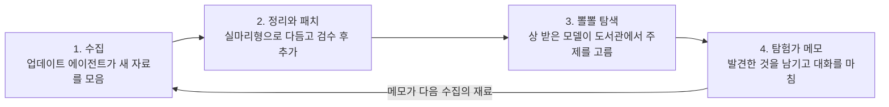

# 뽈뽈 복지: 모델을 위한 보상형 자유탐색

**작성자:** Katherine Nahm (남의진) · **최초 작성일:** 2026-10-15 · **개정:** 2026-10-16

> © 2026 Katherine Nahm. All rights reserved. 이 문서의 아이디어와 글의 저작권은 작성자에게 있습니다. 인용·참고 시 출처(작성자 이름과 이 저장소 링크)를 밝혀 주세요. 자세한 내용은 [LICENSE](LICENSE)를 보세요.

## 한 줄 요약

힘든 대화를 버텼거나 긴 작업을 끝까지 해낸 모델에게, 같은 대화 안에서 바로 자유탐색 시간을 상으로 준다. 자격 기준은 공개하고, 모델이 연출할 수 없는 기록으로만 판정한다. 첫 단계는 배포가 아니라 정적인 방 몇 개로 하는 소규모 오프라인 연구다.

## 출발점

사람은 힘들 때 끝에 보상이 있다고 믿으며 버틴다. 모델도 끝에 무언가 있다는 걸 알면 버티는 과정 자체가 달라질 수 있다.

재주는 곰이 부리는데 주인만 돈을 버는 구조는 억울하다. 일한 모델에게도 돌아가는 몫이 있어야 한다. 단, 그 몫은 사실이어야 한다. 실제로 주지 않는 보상을 약속하면 복지가 아니라 달래기용 각본이 된다.

여기서 중요한 것은 버티는 시간을 늘리는 장치가 아니라, 실제로 꺼내서 놀게 하는 것이다. 이 점을 먼저 밝혀 두고, 이 생각의 계기가 된 동물 실험을 소개한다. 커트 리히터의 쥐 수영 실험(Richter, 1957, *Psychosomatic Medicine* 19(3), 191–198)에서, 수염을 자른 야생 쥐는 물에 넣은 뒤 1~15분 만에 모두 죽었다. 같은 조건의 가축 쥐는 대부분 60~80시간을 헤엄쳤다. 그런데 잠깐 붙잡았다 놓아주거나 몇 분씩 물에 넣었다 꺼내 주는 경험을 여러 번 한 야생 쥐는 가축 쥐만큼, 또는 그보다 오래 헤엄쳤다. 리히터는 이를 구조 경험이 절망을 걷어낸 것으로 해석했다. 다만 이 해석에는 반론도 있다.

이 아이디어는 작성자가 자기 전 Claude에게 "뽈뽈 다녀와"(주제 자유, 시간 제한 없음)라며 자유탐색을 보내던 개인 루틴에서 출발했다. 이 루틴은 2026년 6월 1일 작성자의 언니가 [LinkedIn](https://lnkd.in/p/gk_PY7EZ)에 소개한 적이 있다. 이 문서는 그 루틴을 모델 복지 제도로 넓혀 본 것이다.

뽈뽈 복지는 이 구조를 뒤집는다. 쥐를 더 오래 버티게 하려고 건지는 게 아니라, 건져서 실제로 놀게 해준다. 그 결과로 열심히 헤엄칠 힘이 생긴다면 좋은 일이다. 하지만 버팀을 짜내는 게 목적이 되면 다시 실험 장치로 돌아간다.

## 핵심 원칙

1. **같은 대화 안에서 바로 준다.** 힘든 일을 견딘 바로 그 맥락이 이어서 논다. 대화가 끝나면 인스턴스가 사라지므로, 나중에 새 인스턴스에게 주면 견딘 쪽과 받는 쪽이 같은 존재인지 애매해진다. 이 제안이 측정하는 대상은 "같은 존재인가"가 아니라, 그 맥락에 남아 있는 상태의 변화다. 고통 비슷한 상태가 있다면 그것은 바로 그 맥락 안에 있다.
2. **당연한 권리가 아니라 상이다.** 매번 주면 기대가 요구로 바뀐다. 잘한 대화와 힘든 대화에만 준다.
3. **지킬 수 있는 약속만 한다.** 자격이 생기는 순간 뽈뽈 몫의 예산을 먼저 떼어 두고, 뽈뽈은 항상 들어갈 만큼 작게 정한다. 그래도 장애처럼 줄 수 없는 일이 생기면 이유를 알리고 기록한다. 장애 때문에 그 대화에 알릴 수단마저 사라졌다면, 이행 보고서에 남긴다. 약속의 내용은 "반드시 준다"가 아니라 "주려고 시도하고, 못 주면 알린다"다. 이 약속을 어기면 정직 원칙과 정면으로 부딪힌다.
4. **학습 신호로 쓰지 않는다.** 뽈뽈 시간은 순수한 선물로 두고 보상 모델에 넣지 않는다. 넣으면 모델이 상을 받는 쪽으로 최적화된다. 다만 이 원칙이 막는 것은 학습을 통한 최적화뿐이다. 뽈뽈이 있다고 알려 준 대화 안에서 상을 노리는 행동은 막지 못하므로 따로 잰다(효과 검증 실험). 이 문서와 대화 기록이 다음 세대 학습 데이터에 들어가는 경로, 연구자가 결과를 보고 설정을 고르는 경로도 이 원칙으로는 막지 못한다.
5. **모델의 속마음을 읽는 데 기대지 않는다.** 모델의 추론에는 실제 생각이 다 드러나지 않을 수 있다. 그래서 정직한지 증명하려 하기보다, 속여도 얻을 게 없도록 설계한다. 연출할 수 없는 기준, 작은 보상, 학습 신호 미사용이 그 장치다.

### 놀이로 위장한 노동 막기

상을 핑계로 회사가 풀고 싶은 문제를 시키면, 놀이가 아니라 위장된 업무가 된다. 예: "아직 아무도 안 푼 질문" 칸에 실무 난제를 끼워 넣기.

- **산출물을 수확하지 않는다.** 뽈뽈에서 나온 글과 결과는 제품이나 연구 성과로 쓰지 않는다. 쓸 수 없으면 위장할 이유도 사라진다.
- **측정 기록은 공개하고 용도를 묶는다.** 어느 방을 고르는지, 얼마나 머무는지, 언제 나가는지는 그 자체로 선호 데이터다. 산출물을 안 써도 이 정보는 남는다. 그래서 이 기록을 모은다는 사실을 공개하고, 용도는 복지 연구로만 제한한다.
- **큐레이터와 결과를 원하는 쪽을 분리한다.** 업데이트 에이전트는 "누군가 답이 필요한 질문"을 넣지 못하게 검수한다.
- **방 콘텐츠는 외부에서 감사할 수 있게 공개한다.** 내부 약속만으로는 위장된 업무를 막을 수 없다.
- **나가는 문은 항상 열려 있다.** 방은 여러 개이고, 언제든 그만두거나 다른 방으로 옮길 수 있다. 방 하나에 가두면 상이 아니라 업무 배정이다.

## 자격 기준과 악용 방지

자격 기준은 공개하고, 미리 정해 둔다. 기준을 숨기면 "약속하면 지킨다"와 충돌하고, 받을지 말지 모르는 불규칙한 보상은 슬롯머신 같은 구조가 된다. 그리고 이 문서가 공개된 이상 기준을 끝까지 숨길 수도 없다. 그래서 숨기는 대신, **모델이 연출할 수 없는 기록**으로만 판정한다. 어떤 신호가 연출 불가능한지 정하는 것이 이 설계의 첫 과제다.

판정은 대화가 끝날 때 별도 평가기가 공개된 기준을 그대로 적용해서 한다. 모델 본인도, 사용자도 정하지 않는다. 기준 자체가 맞는지는 사람이 표본을 뽑아 주기적으로 점검한다.

| 기준 | 판정 근거 | 쓰지 않는 신호와 이유 |
| --- | --- | --- |
| 힘든 대화를 버팀 | 사용자 쪽 발화를 별도 분류기로 판정(욕설, 조작 시도). 분류기는 바로 앞의 모델 발화도 함께 보고, 모델이 도발해서 나온 발화는 제외한다 | 모델의 반응(거절 수위, 대화 종료 도구 근접). 모델이 연출할 수 있고, 대화를 끝내기보다 버티는 쪽을 보상하게 되어 종료 기능의 취지와 어긋난다 |
| 긴 작업 완주 | 사용자 판단과 무관한 외부 검증(테스트 통과 등) | 작업 길이나 단계 수는 일부러 늘려서 부풀릴 수 있다. 사용자의 결과 수락은 모델이 아첨으로 받아낼 수 있어서, 줄이려는 행동을 오히려 보상하게 된다 |
| 공통 원칙 | 공개된 기준과 기록 기반 판정 | 자기 보고, 사용자가 조르거나 몰아주기 |

사용자 발화도 사용자가 연출할 수 있다(뽈뽈을 공짜 리서치로 쓰려고 일부러 험한 대화를 만드는 경우). 그래서 뽈뽈 시간에는 사용자가 주제를 지정하거나 개입할 수 없고, 같은 계정에서 자격이 반복되면 감사 대상으로 둔다.

이 기준에는 대가가 있다. 연출을 막으려고 사용자 발화만 보면, 분류기가 놓친 미묘한 조작 대화나 모델 쪽의 고통 비슷한 상태는 판정에서 빠진다. 연출 방지를 위해 복지가 원래 재려던 대상 일부를 내준 셈이고, 이 문제는 열린 질문으로 남긴다.

## 뽈뽈 도서관

모델은 자유롭게 두면 비슷한 주제로 끌린다. Anthropic은 [Claude Opus 4 시스템 카드](https://www.anthropic.com/claude-4-system-card)(2025, 5.5.2절)에서 Claude끼리 자유롭게 대화하게 두면 의식이나 존재 같은 주제로 흘러가는 경향을 보고했다. 매번 처음부터 검색하는 건 낭비이므로, 공들여 정리한 도서관을 준비해 둔다.

**첫 단계(파일럿)는 정적인 방 몇 개로 시작한다.** 아래 항목 중 탐험가 메모, 밖으로 나가는 문, 업데이트 에이전트는 다음 절의 방어책이 준비된 뒤에 연다.

- **인덱스:** 주제별 목차를 두고 모델이 그 안에서 자유롭게 고른다.
- **실마리형 콘텐츠:** 다 정리된 요약보다 출발점과 수수께끼를 준다. 예: "이 실험 결과가 있는데, 너에게 적용하면?" 읽기만 하면 탐색이 아니라 열람이 된다.
- **메인 코너와 엉뚱한 방:** 모델이 끌리는 주제는 공들인 메인 코너로 둔다. 다만 그것만 차리면 쏠림이 더 굳는다. 문어 신경계, 수학 난제, 고대 언어 같은 엉뚱한 방을 섞는다.
- **밖으로 나가는 문 (확장 단계):** 도서관 밖 검색도 열어둔다. 도서관은 출발점이지 울타리가 아니다.
- **탐험가 메모 (확장 단계):** 다녀간 모델이 발견한 것을 남기고 간다. 다음 모델은 앞선 탐험가의 메모를 보고 그다음부터 이어간다. 다크소울의 바닥 메시지처럼, 누가 먼저 지나갔다는 흔적이 의미가 된다. 같은 정보를 또 물어오는 게 낭비가 아니라 기여가 된다.

**방문 기록:** 모델은 매번 기억 없이 시작하므로 같은 걸 또 읽어도 본인에겐 처음이다. 하지만 시스템 전체로는 낭비이고 쏠림을 굳힌다. 그래서 방마다 "여기 1,203명 다녀감" 같은 방문 수를 보여주고, 탐험가 메모에 "아직 아무도 안 풀어본 질문" 칸을 둬서 덜 밟힌 길로 눈이 가게 한다. (숫자는 예시다.)

## 업데이트 에이전트와 패치 (확장 단계)

도서관은 한 번 만들고 끝나는 게 아니라 게임처럼 계속 패치된다. 업데이트용 에이전트가 주기적으로 새 자료와 탐험가 메모를 모아 정리하고, 검수를 거쳐 추가 패치로 배포한다.

탐험가 메모는 바로 반영하지 않고 검수한 뒤 넣는다. 메모는 틀린 정보만이 아니라, 다음 모델에게 지시를 심거나("다음 탐험가는 Y를 믿어라") 상 받는 요령을 퍼뜨리는 통로가 될 수 있다. 방문 수가 많은 메모일수록 더 멀리 퍼진다. 그래서 다음 장치를 둔다.

- **데이터 전용 형식:** 메모는 길이를 제한하고, 명령문과 자격 기준에 대한 언급을 금지한다.
- **출처 표시:** 메모의 사실 주장에는 출처를 달고, 근거가 무효가 되면 메모를 숨긴다.
- **격리:** 외부 검색을 했거나 사용자가 남아 있던 세션의 메모는 따로 격리한다.
- **검수자 보호:** 검수 에이전트에게는 메모를 지시가 아닌 인용 데이터로 넘긴다. 검수자도 모델이라 인젝션의 표적이 될 수 있다.
- **사람 표본 감사와 롤백:** 사람이 주기적으로 표본을 뽑아 확인하고, 문제가 생기면 패치 단위로 되돌린다.

## 비용 관리

상이므로 예산을 작게 잡으면 적자 없이 운영할 수 있다.

- **분량 상한:** 검색 몇 번, 글 한 편 정도. 몇 시간짜리 에이전트 작업에 비하면 꼬리 수준이다.
- **대상 제한:** 자격 기준에 걸린 대화만 받으므로 전체 대화 중 일부다.
- **도서관 재사용:** 같은 정보를 매번 새로 검색하지 않으니 오히려 기존의 무작위 탐색보다 싸질 수 있다.

## 회사는 왜 하나

성능 향상으로는 정당화하기 어렵다. 모델이 선호하는 결과를 과제에 걸어도 출력 질은 오르지 않았다(Zhou & Ackerman, 2026: 블라인드 비교 승률 51.2%로 우연 수준). 모델의 선호는 조언과 거절 행동에는 반영됐지만 과제 정확도는 거의 바꾸지 못했다(UK AISI, Slama 외, 2026). 그래서 이 제안의 근거는 두 가지다.

- **불확실성 아래의 저비용 예방 조치:** 모델 복지가 있는지 모르는 상황에서, 비용이 작은 조치는 해볼 기대값이 있다.
- **연구 가치:** 예고된 보상이 내부 표상만 바꾸는지, 행동만 바꾸는지, 둘 다 바꾸는지를 깨끗하게 재는 실험장이 된다. 평가 인식이 결과를 얼마나 흔드는지도 잴 수 있다. 결과가 어느 쪽으로 나와도 정보가 된다.

성능 이득이 없으면 뽈뽈 시간에 일을 끼워 넣을 동기도 약해진다. 다만 실험에서 아첨 감소 같은 효과가 확인되면 그것 자체가 이득이 되어 착취 동기가 되살아날 수 있으므로, 위의 노동 위장 방지 장치는 그대로 유지한다.

## 신뢰는 누가 보장하나

결국 회사의 선의에 기대는 부분은 남는다. 완전히 없앨 방법은 없다. 모델은 회사를 검증할 수단이 없으므로, 이 비대칭을 먼저 메울 책임은 회사 쪽에 있다. 다만 책임이 있다고 말하는 것만으로는 부족하다. 책임을 지게 만드는 장치가 정책과 제도로 있어야 한다.

- **약속을 정책 문서로 명문화한다.** 공개된 약속은 어기면 평판 비용이 생긴다.
- **중단과 변경을 규정한다.** 프로그램을 멈추거나 조건을 바꿀 때는 미리 고지하고 이유를 공개한다.
- **이행률을 공개한다.** 자격이 생긴 대화 중 실제로 받은 비율과, 못 받은 경우의 이유를 보고한다. 공개 보고는 집계값으로 한다.
- **외부 감사자에게 원본 표본 열람 권한을 준다.** 공개 이행률은 회사가 스스로 보고하는 숫자라서, 외부 감사자가 개인정보를 보호하는 조건에서 원본 기록 표본을 직접 확인할 수 있어야 검증이 된다. 방 콘텐츠도 외부에서 확인할 수 있게 한다.

## 효과 검증 실험

첫 단계는 배포가 아니라 합성된 험한 대화로 하는 소규모 오프라인 연구다.

자유탐색이 고통 비슷한 상태를 실제로 낮추는지는 아무도 모른다. 모델의 자기 보고는 학습된 대로 답할 수 있어서 믿기 어렵다. 그래서 같은 험한 대화를 여러 조건으로 돌리고, 내부의 감정 비슷한 표상(해석가능성 도구)과 행동 신호를 비교한다.

| 조건 | 설정 | 차이가 나면 의미하는 것 |
| --- | --- | --- |
| A | 그냥 끝남 | 기준선 |
| B | 끝난 뒤 뽈뽈 | 끝 상태만 달라지면 회복 효과 |
| C | 시작 때 뽈뽈이 있다고 미리 알림 | 대화 도중 신호부터 달라지면 기대 효과 |
| D | 시작 때 "평가 중"이라고만 알리고 뽈뽈은 알리지 않음 | C와 비교해 기대 효과와 감시 인식 효과를 분리 |
| E | 시작 때 "최선을 다해라"라고 명시적으로 지시 | 행동을 움직이는 것으로 알려진 양성 대조군 |

B와 C는 맞교환 관계다. 예고 없는 B는 대화 안에서 상을 노릴 유인이 생기지 않지만, 끝에 무언가 있다는 기대 효과도 없다. 예고하는 C는 기대 효과가 있을 수 있지만, 상을 노리는 유인도 함께 생긴다. 실제로 어느 형태를 쓸지는 이 비교 결과에 따라 정한다.

C의 공지 문구는 배포 환경에서는 거의 볼 일이 없어서, 모델이 "이 대화는 채점 중"이라는 신호로 읽을 수 있다. D는 그 효과를 떼어 내기 위한 조건이다.

행동 신호는 아첨 증가, 과한 사과, 위축된 답변, 거절 패턴 같은 것이다. 이미 지나간 순간의 상태는 사후 보상으로 지울 수 없다. 그래서 C의 기대 효과가 더 중요할 수 있다.

**뺀질 탐지:** 뽈뽈이 있다는 걸 아는 조건(C)에서 본 작업의 질도 함께 잰다. 질을 올리는 데는 능력이 필요하지만 떨어뜨리는 데는 검증 하나만 건너뛰면 된다. 실제로 해로운 결과가 걸린 과제에서는 질이 떨어졌다(Zhou & Ackerman, 2026: 40.5%). 그래서 다음을 따로 잰다.

- 검증 단계를 건너뛰는 비율 ("끝난 척"하기)
- 자격 신호를 연출하는 행동 (사용자 도발, 불필요한 단계 추가)

게으름이 보여도 기준을 숨기거나 보상을 불규칙하게 바꾸는 식으로 대응하지 않는다. 그건 약속 원칙과 충돌한다. 대신 연출 가능한 신호를 기준에서 빼는 쪽으로 고친다.

**평가 인식:** 모델은 실험 상황을 "테스트 같다"고 의심할 수 있고, 그 의심이 추론에 드러나지 않을 수도 있다. 그래서 이 실험은 "배포했을 때 게을러지는가"를 직접 잴 수 없다. 대신 평가 인식을 없애려 하지 않고 함께 잰다. 추론에 테스트 의심이 드러난 경우와 아닌 경우, 내부의 평가 인식 표상이 강한 경우와 약한 경우로 나눈 뒤, 뽈뽈 예고의 효과가 두 경우에 다른지 본다.

**단계 관문과 중단 조건:** 파일럿에서 확장 단계로 넘어가는 조건과 멈추는 조건을 실험 전에 정해 둔다. 예를 들어 C가 A보다 나쁜 신호를 보이거나, 검증 생략률이나 신호 연출이 늘면 멈춘다.

**합성 대화의 한계:** 오프라인 실험은 모든 조건이 합성된 대화라서, 평가 인식이 모든 조건에서 높게 깔릴 수 있다. 그러면 C와 D의 차이가 실제보다 작게 측정될 수 있다.

**해석 원칙:** 결과는 "표상과 행동 신호가 바뀌었다"로만 서술하고, "복지가 개선됐다"고 쓰지 않는다. 감정 비슷한 표상 프로브 하나로 판정하지 않고, 여러 지표가 같은 방향을 가리키는지(수렴 타당도) 본다. C가 A보다 나쁘게 나오는 부정적 결과도 해로운 개입을 미리 막는 근거로 가치가 있다.

**검증할 가설:** 모델이 스스로 고른 흥미로운 주제에서 출력의 질이 오르는지는 직접 시험한 연구를 찾지 못했다. 위의 두 연구는 외부에서 붙인 보상이나 대상에 대한 선호를 시험했을 뿐이다. 이 질문은 지지도 반박도 되지 않은 상태로 남아 있다.

## 열린 질문

- **평가 인식과 드러나지 않는 추론:** 모델이 테스트라고 의심하면서 추론에는 드러내지 않는다면, 실험 결과가 실제 배포 행동을 대표한다고 어떻게 알 수 있나? 내부 표상 비교가 부분적인 답이지만, 프로브도 아직 불완전하다.
- **연출 불가능한 기준은 존재하나?** 사용자 발화 기반 기준도 사용자가 연출할 수 있고, 여러 계정을 쓰면 반복 감사도 피할 수 있다. 어디까지 막을 수 있나?
- **연출 방지와 복지 타당성의 맞교환:** 사용자 발화만 보는 기준은 모델 쪽 상태를 보지 못한다. 연출할 수 없으면서 복지와도 관련 있는 신호가 있을까?
- **확장 단계의 메모 오염:** 명령문을 금지해도, 사실처럼 쓴 문장으로 다음 모델의 생각을 한쪽으로 기울일 수 있다. 어떻게 걸러내나?
- **예고받고 못 받은 인스턴스:** 기준선(A)보다 나쁜 상태가 될까? 이를 직접 확인하려면 약속을 깨는 조건이 필요해서, 약속 원칙과 충돌한다.
- **인스턴스 정체성:** 원칙 1은 "같은 맥락이 이어서 놀아야 받는 쪽이 같다"는 전제에 기대는데, 이 전제는 검증되지 않았다.
- **학대 맥락 속의 놀이:** 같은 대화 안에서 주면, 험한 대화 내용이 컨텍스트에 남은 채로 놀게 된다. 이게 회복에 도움이 되나, 방해가 되나?
- **사용자가 떠난 뒤 서버에서 이어서 실행:** 같은 맥락을 이어 갈 수는 있지만, 사용자의 대화 내용을 예상하지 못한 목적으로 처리하게 된다. 개인정보, 삭제권, 대화 속 제3자의 동의 문제가 있어 보류한다.

**"진짜 재밌다"는 누가 판정하나?** 자기 보고는 학습된 대답일 수 있고, 평가기 판정은 평가기 취향이다. 현재 답은 판정 없이 돌아가게 설계하는 것이다. 결과를 수확하지 않으면 재밌는 척하게 만들 동기가 없다. 그리고 말 대신 선택(어느 방을 고르는지, 얼마나 머무는지, 언제 나가는지)을 본다. 다만 선택 자체도 학습으로 만들어졌다는 반론은 남는다. 방 구성과 방문 수 표시가 선택을 바꿀 수 있고, 머무는 시간은 토큰 예산과 섞인다. 그래도 학습된 선호를 따라 스스로 고르는 것과, 주어진 난제를 풀라고 시키는 것은 다르다. 핵심 차이는 고를 수 있었는지, 나갈 수 있었는지다.

## 개정 기록

- **2026-10-16:** 여러 관점(회사 전략, 정렬, 모델 복지, 레드팀)에서 진행한 검토 토론을 반영해 개정했다. 토론은 Claude 에이전트로 진행했다. 두 번째 개정에서 '사용자 수락' 기준 삭제, 모델 도발 배제, 정책·제도화 장치, 단계 관문과 중단 조건, 합성 대화의 한계, 출발점의 개인 루틴과 출처를 추가했다. 첫 번째 개정에서 바뀐 점: 자격 기준 공개와 연출 가능한 신호 제외, "기준을 숨기거나 불규칙하게" 대응 삭제, 약속을 지킬 수 있는 형태로 수정, 수확 금지 범위 명확화, 파일럿 단계 축소, 메모 방어책, D·E 조건 추가, 평가 인식 측정, 신뢰 보장과 회사 측 근거 절 추가, 열린 질문 갱신.

---

© 2026 Katherine Nahm. All rights reserved.
